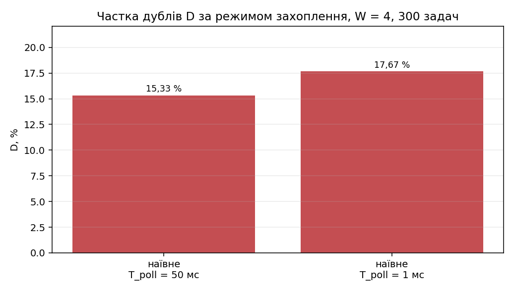
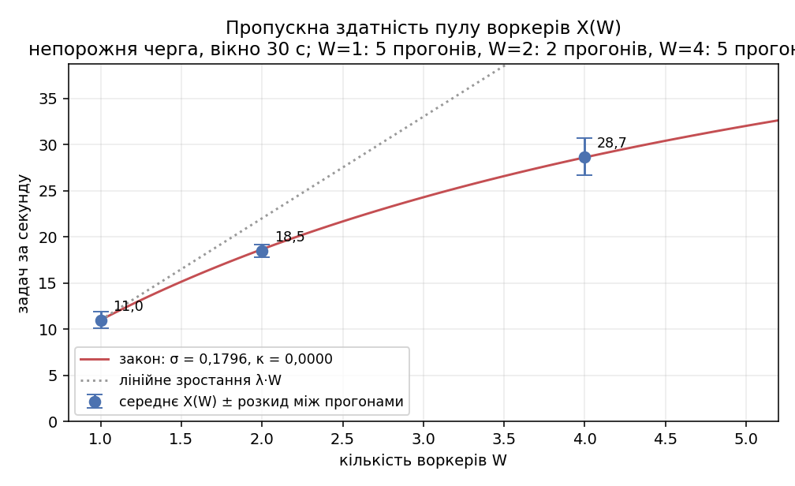
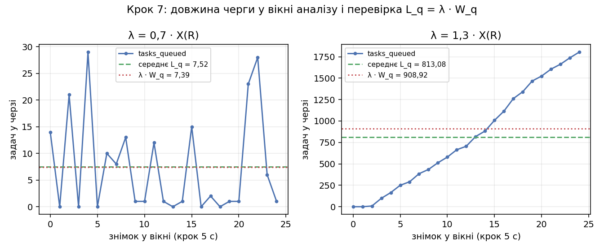
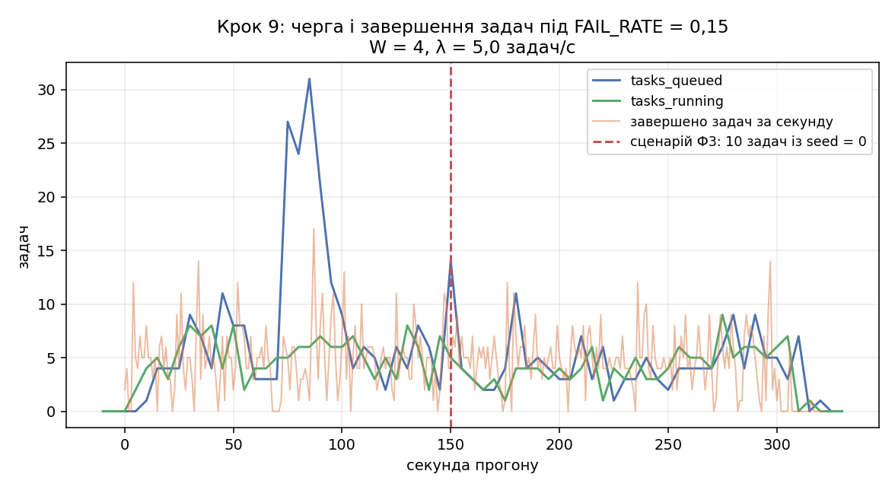
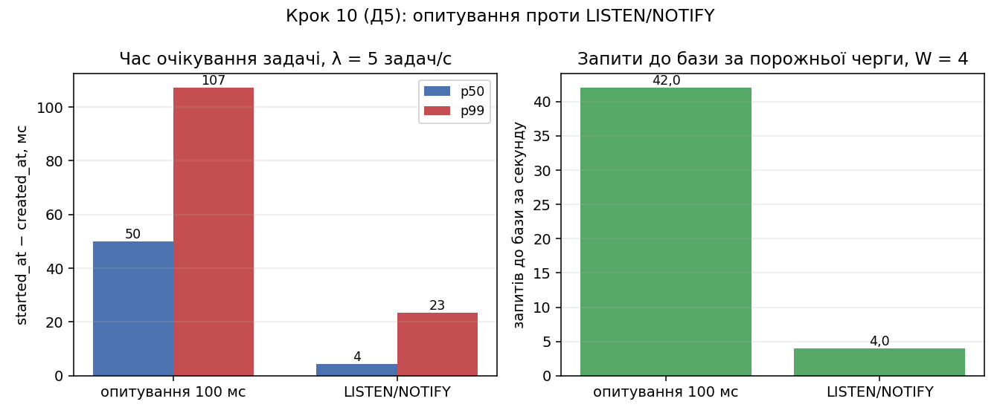

# Звіт: лабораторна робота 4. Синхронізація пула воркерів

**Варіант 19.** Сервіс із ЛР1–ЛР3: реєстр донорів, ресурс `/donor-registry`
([REPORT.md](REPORT.md), [REPORT-LAB2.md](REPORT-LAB2.md), [REPORT-LAB3.md](REPORT-LAB3.md)).

| Параметр варіанта | Значення |
|---|---|
| Квантилі вікна яскравості q_lo / q_hi | 0,02 / 0,98 |
| Інтервал опитування T_poll | 50 мс |
| Тривалість lease L | 5 с |
| Сценарій відмови | Ф3: задачі з `seed = 0`, на якому крок обробки викидає виняток |
| Додаткова вимога | Д5: LISTEN/NOTIFY замість опитування |
| R, найбільша кількість воркерів | 4 (з ЛР3) |
| Розмір зрізу S | 256 (однаковий для всіх варіантів) |
| `max_attempts` | 3 |

Запуск: [RUN-LAB4.md](RUN-LAB4.md). Детальна інструкція і перевірки:
[HOWTO-LAB4.md](HOWTO-LAB4.md). Сирі дані: `results/lab4/`. Усі таблиці, зведені скриптом із
сирих даних: [results/lab4/tables.md](results/lab4/tables.md). Протокол перевірки стенду:
[results/lab4/checks.md](results/lab4/checks.md) — 17 перевірок, усі пройдені.

## Умови

- Та сама машина, що й у ЛР2–ЛР3: Windows 11, 8 логічних ядер, 15,8 ГБ ОЗП, Docker Desktop
  (WSL2) з 8 CPU і 7,6 ГБ.
- Той самий кластер kind v1.37.0 з трьох вузлів, що в ЛР3. База і моніторинг на вузлі
  control-plane, поди `web` і `worker` на двох worker-вузлах.
- Інтервал збору Prometheus 5 с. Порти хоста 18080 (сервіс) і 19090 (Prometheus) — як у ЛР3.
- Воркер: `requests.cpu` 250m, `limits.cpu` 500m, `limits.memory` 512Mi,
  `terminationGracePeriodSeconds` 30.
- Сто записів сутності ті самі, що в ЛР1–ЛР3; їхні ідентифікатори в `loadgen/ids.json`.

## Що додано до стенду

| Що | Де |
|---|---|
| Таблиці `tasks` і `task_results`, індекси, тригер NOTIFY | [db/schema-lab4.sql](db/schema-lab4.sql) |
| Job міграції ЛР4 | [k8s/base/13-db-migrate-lab4-job.yaml](k8s/base/13-db-migrate-lab4-job.yaml) |
| Три ендпоінти черги, вимірювачі `tasks_queued` і `tasks_running`, повернення задач зі спливлим lease | [app/main.py](app/main.py) |
| Воркер із власним образом | [worker/main.py](worker/main.py), [Dockerfile.worker](Dockerfile.worker) |
| Крок обробки зрізу | [worker/slice.py](worker/slice.py) |
| Наглядач процесу воркера (крок 9) | [worker/supervise.py](worker/supervise.py) |
| Deployment і ConfigMap воркера, PodMonitor | `k8s/base/30-*`, `31-*`, `k8s/monitoring/worker-podmonitor.yaml` |
| Генератор задач | [loadgen/tasks.py](loadgen/tasks.py) |
| Прогони, таблиці, діаграми, самоперевірка | `scripts/lab4_*` |

Сам сервіс `web`, база, балансування і моніторинг з ЛР3 не змінювались, крім доданих
ендпоінтів і двох вимірювачів.

## Крок 1. Схема черги і ендпоінти

```sql
CREATE TABLE tasks (
    id BIGINT GENERATED ALWAYS AS IDENTITY PRIMARY KEY,
    record_id BIGINT NOT NULL REFERENCES donor_registry (id) ON DELETE CASCADE,
    status TEXT NOT NULL DEFAULT 'queued'
           CHECK (status IN ('queued','running','done','failed')),
    seed BIGINT NOT NULL CHECK (seed >= 0 AND seed < 2147483648),
    attempts INTEGER NOT NULL DEFAULT 0, max_attempts INTEGER NOT NULL DEFAULT 3,
    token INTEGER NOT NULL DEFAULT 0,
    lease_until TIMESTAMPTZ, worker_id TEXT,
    created_at TIMESTAMPTZ NOT NULL DEFAULT now(),
    started_at TIMESTAMPTZ, finished_at TIMESTAMPTZ);
CREATE INDEX idx_tasks_status_created ON tasks (status, created_at);

CREATE TABLE task_results (
    task_id BIGINT PRIMARY KEY REFERENCES tasks (id) ON DELETE CASCADE,
    token INTEGER NOT NULL, worker_id TEXT NOT NULL,
    result JSONB NOT NULL, created_at TIMESTAMPTZ NOT NULL DEFAULT now());
```

| Ендпоінт | Поведінка |
|---|---|
| `POST /donor-registry/{id}/tasks` | 202 і тіло задачі; 404, якщо запису немає |
| `GET /tasks/{id}` | 200 зі станом задачі і полем `result`, якщо результат є; 404 |
| `GET /tasks` | перелік, фільтр `status`, пагінація `limit` і `offset` |

`seed` генерує сервіс: `random.randrange(1, 2**31)`, тобто значення з домену генератора зрізу.
404 на неіснуючий запис ловиться не окремим `SELECT`, а порушенням зовнішнього ключа
(`errors.ForeignKeyViolation`): інакше між перевіркою і вставкою запис міг би зникнути, і
замість 404 вийшло б 500.

**Понад умову: частковий індекс** `idx_tasks_running_lease (lease_until) WHERE status =
'running'`. Повернення задач зі спливлим lease шукає `WHERE status = 'running' AND lease_until
< now()`; індекс за `(status, created_at)` для цього предикату не годиться.

**`seed = 0` дозволений навмисно.** Домен генератора зрізу це 1 ≤ seed < 2³¹, і нуль лежить
поза ним — саме на ньому крок обробки викидає виняток. Це сценарій відмови Ф3, тому в таблиці
нуль лишається допустимим значенням, а створюється така задача окремим службовим шляхом
`POST /donor-registry/{id}/tasks/poison`, не видимим у схемі API.

**Вимірювачі `tasks_queued` і `tasks_running`** сервіс оновлює фоновою задачею кожні 5 секунд
одним запитом `SELECT status, count(*) ... GROUP BY status`, а не на кожне звернення до
`/metrics`: інакше кожен збір Prometheus коштував би два `count(*)` по всій таблиці.

**Повернення задач зі спливлим lease виконує сервіс**, а не воркер. Умова дозволяє і те, і те.
Один запит на 5 секунд проти W запитів на кожне захоплення: за порожньої черги на чотирьох
воркерах із `T_poll = 50 мс` варіант у воркері дав би 80 додаткових запитів до бази за
секунду, і метрика «запитів до бази за порожньої черги» з вимоги Д5 міряла б переважно їх.
Варіант у воркері лишився під ключем `REAP_IN_WORKER=1`.

## Крок 2. Воркер, крок обробки і базові тривалості

Воркер — окремий процес із власним образом `donor-worker:lab4` на `python:3.12-slim`:
ні FastAPI, ні uvicorn, ні пулу зʼєднань сервісу в ньому немає. `WORKER_ID` заповнюється
іменем пода через Downward API, адреса бази і сервісу, `L`, `T_poll` і `FAIL_RATE` — зі змінних
середовища.

Метрики воркера на порту 9100: `worker_tasks_total{result}` (`done`, `failed`, `lost`),
`worker_claims_total{result}` (`task`, `empty`), `worker_task_duration_seconds{step}`
(`claim`, `fetch`, `process`, `store`), `worker_tasks_in_flight`. Понад умову додані
`worker_db_queries_total{kind}` (потрібен вимозі Д5), `worker_stale_token_total{op}` і
вимірювач-мітку `worker_config`, за яким у вже знятих даних видно, у якому режимі йшов прогін.

Крок обробки зрізу — лише цикли Python, без NumPy і Numba
([worker/slice.py](worker/slice.py)). `mod 2^31` реалізовано як `& 0x7FFFFFFF`, зсув на 19
лишає 12 старших бітів із 31. Округлення `⌊4095·(p − p_lo)/(p_hi − p_lo)⌉` зроблено
цілочисельно, `(2a + b) // 2b`, щоб результат не залежав від порядку операцій із плаваючою
комою: тоді результат задачі однаковий у будь-якого воркера, і ідемпотентність запису має сенс
перевіряти.

На одному воркері виконано 20 задач:

| Величина | Середнє, мс | p50, мс | p99, мс | Мін., мс | Макс., мс |
|---|---|---|---|---|---|
| t_io (крок 1 + крок 3 задачі) | 11,49 | 10,64 | 21,76 | 9,48 | 23,75 |
| t_cpu (обробка зрізу) | 64,77 | 68,69 | 139,92 | 29,21 | 153,83 |

t_io + t_cpu = **76,3 мс**, з півінтервалом опитування — **101,3 мс**, тобто оцінка
1 / (t_io + t_cpu + T_poll / 2) = **9,88 задач/с**. Задача на цьому стенді на 85 % складається
з обчислення: 65 мс обробки проти 11 мс на два звернення (HTTP до сервісу і запис у базу).

## Крок 3. Наївне захоплення дає дублі

`CLAIM_MODE=naive`: `SELECT` найстаршої задачі в статусі `queued`, окремий `UPDATE` статусу на
`running`, без транзакції і без блокувань; результат пишеться `INSERT` без `ON CONFLICT`, а
первинний ключ `task_results` на цей час замінено звичайним індексом. По 300 задач з
інтенсивністю 100 за секунду на R = 4 воркерах:

| T_poll, мс | Задач | Рядків у `task_results` | Задач з > 1 результатом | Задач «виконано» > 1 разу | З них різними воркерами | **D** за результатами | **D** за журналами | Прогін, с |
|---|---|---|---|---|---|---|---|---|
| 50 | 300 | 346 | 46 | 46 | 46 | **0,1533** | **0,1533** | 15,5 |
| 1 | 300 | 357 | 53 | 53 | 53 | **0,1767** | **0,1767** | 17,3 |

Дві оцінки D збігаються точно: кожна задача, що має два рядки в `task_results`, позначена
виконаною двічі й у журналах, і щоразу — двома різними воркерами. Отже дублювання не є
повторним виконанням тим самим воркером.

Зменшення інтервалу опитування з 50 мс до 1 мс **збільшує** D з 15,3 % до 17,7 %. Вікно
перегонів не залежить від `T_poll` — це час між `SELECT` одного воркера і його `UPDATE`, —
але частіше опитування збільшує кількість спроб захоплення, що потрапляють у це вікно: за
прогін воркери зробили 11 тисяч спроб замість 0,6 тисячі.

## Крок 4. Захоплення однією командою

`UPDATE ... WHERE id = (SELECT id ... FOR UPDATE SKIP LOCKED) RETURNING *`, первинний ключ
`task_results` повернуто. Та сама серія, що в кроці 3 (300 задач, 100 за секунду, W = 4), з
`T_poll = 1 мс`. Кожен режим прогнано тричі.

| Режим | Прогін | D | p99 захоплення, мс | Порожніх захоплень | Макс. рядків `Lock` | Знімків | Інтервал знімків, с | Прогін, с |
|---|---|---|---|---|---|---|---|---|
| FOR UPDATE SKIP LOCKED | 1 | **0,0000** | 20,5 | 8320 | 0 | 17 | 1,04 | 18,0 |
| FOR UPDATE SKIP LOCKED | 2 | **0,0000** | 20,8 | 6185 | 9 | 17 | 1,09 | 17,9 |
| FOR UPDATE SKIP LOCKED | 3 | **0,0000** | 9,9 | 8760 | 9 | 14 | 1,03 | 14,8 |
| FOR UPDATE без SKIP LOCKED | 1 | **0,0000** | 8,0 | 6851 | 0 | 15 | 1,09 | 15,2 |
| FOR UPDATE без SKIP LOCKED | 2 | **0,0000** | 17,1 | 7686 | 0 | 16 | 1,03 | 16,8 |
| FOR UPDATE без SKIP LOCKED | 3 | **0,0000** | 8,2 | 10372 | 6 | 14 | 1,10 | 15,5 |

| Режим | Прогонів | Порожніх захоплень | p99 захоплення, мс | Тривалість, с | Макс. рядків `Lock` |
|---|---|---|---|---|---|
| FOR UPDATE SKIP LOCKED | 3 | 7755 (6185–8760) | 17,1 (9,9–20,8) | 16,9 (14,8–18,0) | 0–9 |
| FOR UPDATE без SKIP LOCKED | 3 | 8303 (6851–10372) | 11,1 (8,0–17,1) | 15,9 (15,2–16,8) | 0–6 |

### Що тут справді доведено

**Дублі зникли повністю і відтворювано: D = 0 у всіх шести прогонах**, а також у двох
додаткових із вимкненим тригером. Це головний результат кроку: захоплення стало однією
командою, і рядок, який один воркер уже оновлює, іншому не дістається. Проти D = 0,153 і
0,177 наївного захоплення різниця не потребує статистики.

**Різниці в ціні між двома режимами на цьому стенді не видно.** Розподіли всіх показників
перекриваються: порожніх захоплень 6185–8760 проти 6851–10372, p99 захоплення 9,9–20,8
проти 8,0–17,1 мс, тривалість 14,8–18,0 проти 15,2–16,8 с. Середні навіть трохи на користь
режиму **без** `SKIP LOCKED`, що теорії суперечить, тобто є шумом.

Причину видно з величин: критична секція це один `UPDATE`, що триває частки мілісекунди,
при задачі на 100 мс. Чотири воркери з інтервалом опитування 1 мс стикаються на тому самому
рядку рідко, а коли стикаються — чекають мікросекунди. Теоретична різниця існує, але на
цьому стенді вона лежить глибоко під розкидом між прогонами. Щоб її побачити, потрібні або
значно більше воркерів, або штучно подовжена транзакція захоплення; ні того, ні того умова
не передбачає.

Перша серія, знята по одному прогону на режим, давала протилежну картину — «без
`SKIP LOCKED` на 51 % більше порожніх захоплень і прогін на 22 % довший». Повтор перевернув
усі чотири показники, і саме тому тут наведено по три прогони з розмахом, а не по одному.

### Очікування блокувань походять не від захоплення

Знімок `pg_stat_activity` фіксує не лише кількість, а й те, на чому стоїть очікування. У
прогонах із ненульовим лічильником це щоразу `object @ COMMIT` — не рядок задачі, а
спільний обʼєкт під час фіксації транзакції. Перевірено прямим дослідом: той самий прогін
із **вимкненим тригером** `tasks_notify_insert`:

| Прогін | Макс. рядків `Lock` | На чому |
|---|---|---|
| SKIP LOCKED, тригер увімкнено, 3 прогони | 0–9 | `object @ COMMIT` |
| без SKIP LOCKED, тригер увімкнено, 3 прогони | 0–6 | `object @ COMMIT` |
| SKIP LOCKED, **тригер вимкнено** | **0** | нічого |
| без SKIP LOCKED, **тригер вимкнено** | **0** | один раз `transactionid @ UPDATE tasks SET status = 'done'` |

Очікування створює `pg_notify` з тригера вимоги Д5: генератор вставляє 100 задач за секунду,
кожна вставка шле повідомлення, і фіксації транзакцій серіалізуються на черзі повідомлень.
Це однаково присутнє в обох режимах захоплення і про них нічого не каже. Єдине справжнє
очікування рядка за весь набір прогонів спіймано один раз, без тригера, у режимі без
`SKIP LOCKED` — і не на захопленні, а на `UPDATE tasks SET status = 'done'`.

**Що з цього випливає.** Твердження умови «час захоплення зростає з кількістю воркерів» і
«очікування блокувань видно в `pg_stat_activity`» на цьому стенді за W = 4 підтвердити не
вдалося: сигнал менший за шум, а те, що спершу виглядало як підтвердження, виявилось
побічним ефектом тригера Д5. Підтверджено натомість головне — обидва режими з `FOR UPDATE`
усувають дублі повністю.

Знімки беруться рівно раз на секунду, як вимагає умова: весь цикл виконується одним
`kubectl exec` усередині пода бази (фактичний інтервал 1,03–1,10 с). Варіант «окремий
`kubectl exec` на кожен знімок», з якого починалась робота, давав насправді знімок раз на
2,3 с і 7 точок на 15-секундний прогін.

Для подальших кроків повернуто `SKIP LOCKED` і `T_poll = 50 мс` за варіантом.



## Крок 5. Lease, heartbeat і fencing token

Додано: `lease_until = now() + 5 с` під час захоплення, heartbeat кожні L / 3 ≈ 1,67 с з умовою
`AND token = $token`, повернення задач зі спливлим lease у сервісі кожні 5 секунд, перехід у
`failed` після `max_attempts`, запис результату через `ON CONFLICT (task_id) DO NOTHING` в одній
транзакції із завершенням задачі.

Два воркери, непорожня черга; один воркер зупинено сигналом SIGSTOP на 2 · L = 10 с:

| Що записано | Значення |
|---|---|
| Ідентифікатор задачі в обробці на момент зупинки | **123** |
| Її статус і воркер до зупинки | `running`, `worker-7d859679f7-9wbfm` |
| `attempts` / `token` до зупинки | **1** / **1** |
| `attempts` / `token` після спливання lease | **2** / **2** |
| Статус після спливання lease | `done` |
| Воркер, який завершив задачу | `worker-7d859679f7-v7jk4` (інший) |
| Рядків у `task_results` для цієї задачі | **1** |
| Воркер, що записав результат | `worker-7d859679f7-v7jk4` |
| Рядків журналу зупиненого воркера про нуль оновлених рядків | **1** |

```json
{"ts": 1794081336.112, "worker": "worker-7d859679f7-9wbfm",
 "msg": "нуль оновлених рядків: задача більше не моя", "task": 123, "token": 1}
```

Послідовність повна: lease спливає → сервіс повертає задачу в чергу → другий воркер її
захоплює, `token` стає 2 → зупинений воркер оживає зі застарілим токеном 1, його команда
оновлює нуль рядків, він це бачить і результату не пише → у `task_results` лишається рівно
один рядок. За весь прогін задач з більше ніж одним результатом **0**.

**Команда з умови `kubectl exec ... -- kill -STOP 1` на цьому стенді не діє.** Воркер є
процесом 1 у просторі імен PID контейнера, тобто init цього простору, а ядро доставляє init
сигнал, надісланий зсередини того самого простору, лише за наявності обробника; для SIGSTOP
обробника не буває. Третє поле `/proc/1/stat` після команди лишається `S`. Скрипт прогону
пробує команду з умови, перевіряє стан процесу і переходить на простір імен вузла kind, де
воркер є звичайним процесом:

```
docker exec hpc-worker2 kill -STOP <pid>   →   /proc/1/stat = T
```

Обидві спроби записані в `results/lab4/step5.json` (`documented_command_works: false`,
`stop_via`). Деталі й команди для ручної перевірки — у [HOWTO-LAB4.md](HOWTO-LAB4.md).

Щоб застати воркер саме із задачею в обробці, скрипт пробує зупинку кілька разів: задача
триває ~100 мс, а один цикл «сигнал + запит до бази» — близько секунди. У наведеному прогоні
спрацювала друга спроба; перша застала воркер між задачами, і він був одразу відновлений.
Через це чергу довелось досипати ще однією партією, тому в прогоні 200 задач замість 100.

## Крок 6. Пропускна здатність пулу X(W)

Перед прогоном задачі створюються при нулі воркерів, щоб черга була повна, далі пул
масштабується до W і черга спорожнюється. Умова вимагає один прогін на кожне W; тут їх
знято більше, і нижче пояснено, чому це виявилось необхідним.

| W | Задач у черзі | X(W), задач/с | Розкид усередині прогону | Вікно, с | p99 захоплення, мс | Транзакцій бази за с | CPU пода бази, ядер | У підбір |
|---|---|---|---|---|---|---|---|---|
| 1 | 400 | 9,17 | 2,04 | 30 | 35,0 | 41,1 | 0,076 | ні |
| 1 | 1500 | 11,67 | 2,84 | 30 | 32,7 | 46,5 | 0,113 | так |
| 1 | 1500 | 9,43 | 2,06 | 30 | 30,2 | 36,6 | 0,076 | так |
| 1 | 1000 | 10,97 | 2,46 | 30 | 21,3 | 50,7 | 0,271 | так |
| 1 | 1000 | 11,50 | 2,94 | 30 | 26,5 | 45,6 | 0,167 | так |
| 1 | 1000 | 11,47 | 2,87 | 30 | 16,7 | 44,7 | 0,101 | так |
| 2 | 400 | 18,85 | 4,64 | **20** | 33,6 | 50,1 | 0,081 | ні |
| 2 | 1500 | 19,00 | 5,42 | 30 | 36,4 | 67,9 | 0,153 | так |
| 2 | 1500 | 18,03 | 3,44 | 30 | 24,5 | 62,8 | 0,108 | так |
| 4 | 400 | 32,00 | 7,85 | **12** | 48,2 | 67,6 | 0,119 | ні |
| 4 | 1500 | 30,83 | 8,64 | 30 | 37,4 | 99,3 | 0,230 | так |
| 4 | 1500 | 29,57 | 6,23 | 30 | 43,7 | 95,4 | 0,174 | так |
| 4 | 1000 | 29,70 | 7,25 | 30 | 33,7 | 99,1 | 0,334 | так |
| 4 | 1000 | 27,33 | 8,45 | 30 | 54,3 | 91,5 | 0,168 | так |
| 4 | 1000 | 25,90 | 7,56 | 30 | 72,0 | 85,4 | 0,118 | так |

**Прогін на 400 задачах умову не виконує для W = 2 і W = 4.** X(W) треба брати за останні
30 секунд до спорожнення, але 400 задач при 19 задачах/с спорожнюються за 22 с, а при
32 задачах/с — за 14 с. Доступне вікно коротше за потрібне, тому ці три прогони наведені, але
в підбір закону не входять; решта знята з чергою 1000–1500 задач і повним вікном 30 с.

**Остання секунда прогону з вимірювання вилучена.** Черга спорожнюється десь усередині неї, і
частину секунди воркери вже простоюють. Якщо її врахувати, X занижується на 0,4–1,3 % при
черзі 1500 задач і до 5 % при 400 задачах і W = 4.

### Пропускна здатність не відтворюється між прогонами

| W | Прогонів | X(W), середнє | σ між прогонами | Розмах | Коеф. варіації | Розмах |
|---|---|---|---|---|---|---|
| 1 | 5 | **11,01** | 0,92 | 9,43–11,67 | **8,3 %** | 24 % |
| 2 | 2 | **18,52** | 0,68 | 18,03–19,00 | 3,7 % | 5 % |
| 4 | 5 | **28,67** | 2,00 | 25,90–30,83 | **7,0 %** | 19 % |

Розкид між прогонами того самого W сягає 19–24 %, і він не менший при W = 4, ніж при W = 1:
коефіцієнти варіації 7,0 % і 8,3 % практично однакові. Три послідовні повтори при W = 4,
зняті поспіль протягом десяти хвилин, дали 29,70 → 27,33 → 25,90 задач/с, а p99 захоплення
за ті самі прогони зросла 33,7 → 54,3 → 72,0 мс. Це не випадковий розкид, а дрейф: стенд
повільно втрачає пропускну здатність під безперервним навантаженням. Причина та сама, що в
ЛР2 і ЛР3 — генератор, кластер із трьох вузлів, база, моніторинг і чотири воркери ділять ті
самі вісім ядер хоста.

**Порівняння X(1) з 1 / (t_io + t_cpu + T_poll / 2).** Оцінка за кроком 2 — 9,88 задач/с,
виміряне середнє X(1) = 11,01 задач/с, тобто на 11 % більше. Окремі прогони дали від 9,43
(на 4,6 % нижче оцінки) до 11,67 (на 18 % вище). Модель «воркер по черзі робить три кроки і в
середньому півінтервалу чекає» відтворює порядок правильно, але її точність обмежена тим, що
t_cpu міряний на 20 задачах у кроці 2 сам залежить від завантаження хоста в той момент.

### Закон масштабованості

| W | X(W), задач/с | C(W) | y = W/C(W) − 1 | u | v | Закон, задач/с |
|---|---|---|---|---|---|---|
| 1 | 11,01 | 1,0000 | — | — | — | 11,01 |
| 2 | 18,52 | 1,6823 | 0,1888 | 1 | 2 | 18,66 |
| 4 | 28,67 | 2,6045 | 0,5358 | 3 | 12 | 28,61 |

Σu² = 10, Σv² = 148, Σuv = 38, Σuy = 1,7963, Σvy = 6,8074, Δ = 10 · 148 − 38² = 36.

```
σ = (Σv²·Σuy − Σuv·Σvy) / Δ = (265,85 − 258,68) / 36 = +0,1991
κ = (Σu²·Σvy − Σuv·Σuy) / Δ = (68,07 − 68,26) / 36 = −0,0051
```

Двопараметрична оцінка дала **κ < 0**. За правилом з умови κ = 0, а σ перераховується за
однопараметричною формулою:

```
κ = 0
σ = Σuy / Σu² = 1,7963 / 10 = 0,1796
λ = X(1) = 11,01 задач/с
максимуму немає; межа зростання λ / σ = 61,3 задач/с
```



### Чому σ і κ на цих даних не визначаються

C(W) = X(W) / X(1), тобто **найменш стабільна точка нормує всі інші**. X(1) має розмах
9,43–11,67, і в цих межах підбір дає якісно різні відповіді:

| X(1), задач/с | C(4) | σ двопарам. | κ двопарам. | σ ужито | κ ужито | W* |
|---|---|---|---|---|---|---|
| 9,43 | 3,039 | −0,0676 | +0,0433 | 0,0000 | 0,0259 | **6,21** |
| 10,00 | 2,867 | +0,0284 | +0,0258 | 0,0284 | 0,0258 | **6,13** |
| 10,50 | 2,730 | +0,1132 | +0,0105 | 0,1132 | 0,0105 | **9,21** |
| 11,01 | 2,604 | +0,1991 | −0,0051 | 0,1796 | 0,0000 | немає |
| 11,50 | 2,493 | +0,2827 | −0,0203 | 0,2056 | 0,0000 | немає |
| 11,67 | 2,457 | +0,3109 | −0,0254 | 0,2144 | 0,0000 | немає |

Усередині одного лише розмаху X(1) модель переходить від «σ = 0, κ > 0, максимум при шести
воркерах» до «σ ≈ 0,2, κ = 0, максимуму немає». Це не уточнення числа, а зміна висновку.
Тому:

- **Що стверджувати можна.** Пропускна здатність росте з W сублінійно: C(2) = 1,68 і
  C(4) = 2,60 замість 2 і 4, тобто четвертий воркер додає приблизно половину того, що додає
  перший. Втрати ростуть, і вони видні незалежно від підбору: при W = 4 база робить 85–99
  транзакцій за секунду проти 37–51 при W = 1, а p99 захоплення зростає з 17–33 до 34–72 мс.
- **Чого стверджувати не можна.** Що σ дорівнює 0,18, що κ дорівнює нулю і що максимуму
  немає. Так само не можна було стверджувати і протилежне (σ = 0, κ = 0,023, W\* = 6,6), що
  давала перша серія. Трьох точок із двома параметрами вистачає, щоб крива пройшла через усі
  три, тож збіг кривої з точками на діаграмі нічого не підтверджує.
- **Що потрібно, щоб визначити.** Або стенд, де X(W) відтворюється краще ніж на 20 %, або
  десяток повторів на кожне W з усередненням — на вісьмох ядрах, що їх ділять кластер,
  база, моніторинг і генератор, ні того, ні того немає.

Це той самий висновок, що в ЛР2 (σ і κ з однієї серії — оцінка порядку величини) і ЛР3, і
причина та сама: вузьке місце стенду це процесор хоста, а його завантаження змінюється між
прогонами.

**За X(R) далі взято 28,67 задач/с** — середнє пʼяти прогонів при W = 4. Прогони кроків 7–9
знімались раніше, від початкової оцінки X(R) = 29,1, тому їхні інтенсивності 20,37 і 37,83
задач/с відповідають 0,71 і 1,32 цього середнього. Фактична ж пропускна здатність саме під
час кроку 7 була ще нижчою (22,5 задач/с), тож там ці інтенсивності виявились 0,91 і 1,68 —
про це в кроці 7.

## Крок 7. Закон Літтла для черги

На R = 4 воркерах. Інтенсивність задана від X(R) = 29,1 задач/с — оцінки, яку дав крок 6
на початку роботи. Фактична пропускна здатність пулу на момент цього кроку була нижчою
(див. «Пропускна здатність пулу не стала»), тому в таблиці наведено, якою часткою від неї
кожна інтенсивність виявилась насправді.

| Прогін | λ задана | Тривалість, с | λ виміряна | Частка фактичної X(R) | L_q за вимірювачем | L_q точний | W_q, с | λ · W_q | Розбіжність до точного L_q | Черга на кінець |
|---|---|---|---|---|---|---|---|---|---|---|
| 0,7 · X(R) | 20,37 | 180 | **20,375** | 0,91 | 7,52 ± 1,88 | **7,3884** | **0,36263** | **7,3887** | **+0,0 %** | 0 |
| 1,3 · X(R) | 37,83 | 120 | **37,817** | 1,68 | 813,1 ± 120,7 | **916,80** | 24,035 | 908,92 | **−0,9 %** | 1856 |

Генератор у цих прогонах витримав інтенсивність точно: 20,375 проти заданих 20,37 і 37,817
проти 37,83, **нуль невдалих POST** (у попередній серії, знятій до виправлення клієнта, їх
було 12 і 166).

**L_q рахується двома способами, і це принципово.** Вимірювач `tasks_queued` сервіс оновлює
раз на 5 секунд, тож за вікно 120 с виходить лише 25 знімків. Їхнє середнє має стандартну
похибку 1,88 при самому середньому 7,52, тобто **±25 %**; у попередній серії, де черга була
коротшою (L_q ≈ 0,5 при значеннях знімків 0, 1 і 2), похибка сягала **±48 %**, і будь-яка
«розбіжність у 5 %» там була б меншою за власну похибку вимірювання.

Тому L_q порахований ще й точно, за позначками часу: задача лежить у черзі від `created_at`
до `started_at`, і середнє в часі є сумою перекриттів цих відрізків з вікном, поділеною на
довжину вікна. Дискретизації тут немає взагалі.

```
L_q = Σ (min(started_at, t₁) − max(created_at, t₀)) / (t₁ − t₀)
```

**Сталий режим.** λ · W_q = 7,3887 проти точного L_q = 7,3884 — збіг до **четвертого знака**
(+0,004 %). Черга на кінець прогону порожня, всі 3667 задач виконані. Це найсильніша
перевірка в роботі, і вона стала можливою саме тому, що λ виявилась ближчою до пропускної
здатності, ніж задумувалось: черга з 7,4 задач вимірюється набагато надійніше, ніж черга з
0,5 задачі.

**Понад пропускну здатність.** λ · W_q = 908,9 проти точного L_q = 916,8, розбіжність
**−0,9 %**. Формально закон виконується й тут, але сталого режиму немає: черга весь прогін
зростає лінійно, на кінець у ній 1856 задач, з них **1763** не були захоплені жодного разу.

| Вибірка з прогону 1,3 · X(R) | Задач | Середнє W_q, с | p50, с | p99, с |
|---|---|---|---|---|
| перші 100 захоплених задач | 100 | **0,171** | 0,172 | 0,519 |
| останні 100 захоплених задач | 100 | **51,70** | 51,68 | 52,47 |

W_q зростає в **302 рази** від початку прогону до кінця — саме цим черга, що накопичується,
відрізняється від сталого режиму, де W_q тримався на 0,36 с. «Останні 100 задач» тут це
останні сто з тих, що встигли бути захопленими: для 1763 задач хвоста W_q не визначений
узагалі, і це найпряміший спосіб сказати, що інтенсивність створення перевищила пропускну
здатність пулу. Закон Літтла не вимагає стаціонарності для середніх за замкненим інтервалом,
тому числа узгоджуються і тут; змістовним твердженням про чергу вони перестають бути.



**Про W_q і T_poll / 2.** Умова каже, що за непорожньої черги час від створення задачі до
захоплення вільним воркером лежить від 0 до T_poll і в середньому дорівнює T_poll / 2, тобто
25 мс. Це справджується лише тоді, коли воркер **вільний**, тобто коли λ набагато менша за
пропускну здатність. У першій серії кроку 7, знятій при λ ≈ 0,7 фактичної X(R), виміряний
W_q і становив 25,0 мс — рівно T_poll / 2. У цій серії λ дорівнює 0,91 фактичної X(R),
вільного воркера здебільшого немає, і W_q = 363 мс складається вже не з очікування
опитування, а з очікування в черзі перед зайнятими воркерами. Обидва значення правильні, і
разом вони показують межу застосовності оцінки T_poll / 2.

## Крок 8. Коректна зупинка

За SIGTERM воркер припиняє захоплювати нові задачі, дочікує задачу в обробці і виходить з
кодом 0. Якщо задача не завершилась за `GRACE_S` = 25 с (менше за
`terminationGracePeriodSeconds` = 30 с), потік heartbeat повертає її в чергу командою з умовою
за токеном і процес виходить.

Під прогоном з інтенсивністю 0,7 · X(R) виконано `kubectl rollout restart deployment/worker`:

| Що записано | Значення |
|---|---|
| Коди завершення контейнерів старих подів | **0 (Completed)** для всіх чотирьох |
| Рядків журналу про SIGTERM | 4 (по одному на под) |
| Рядків «зупинка завершена» з `graceful = true` | 4 |
| Задач, повернутих у чергу воркерами під час зупинки | **0** |
| Задач у статусі `failed` | **0** |
| Задач з більше ніж одним результатом | **0** |
| Задач, у яких `attempts` більше 1 | **0** |
| Усього задач / у статусі `done` | 2444 / 2444 |

Генератор у цьому прогоні створив усі 2444 задачі без жодного невдалого POST.

Нуль повернутих у чергу задач — не недогляд, а наслідок тривалості задачі: вона триває ~100 мс
при бюджеті 25 с, тому до спливання бюджету не доходить жодного разу. Бюджет і повернення
реалізовані й перевіряються окремо — у кроці 5 задача повертається в чергу тим самим
механізмом, тільки через lease.

Коди завершення довелось знімати потоково: старі поди зникають за кілька секунд після
перезапуску, і запит після прогону вже нічого не знаходить. Так само журнали старих подів
читаються `kubectl logs -f`, запущеним до перезапуску, інакше рядки про SIGTERM пропадають
разом із подом.

## Крок 9. FAIL_RATE = 0,15 і сценарій відмови Ф3

Воркер читає `FAIL_RATE` і після кроку обробки, до запису результату, з цією ймовірністю
завершує процес `os._exit(1)` — без обробки сигналів і без закриття зʼєднань.

### Прогін за умовою зупиняє пул не тим, чим мав би

Перший прогін зроблено дослівно за умовою: `FAIL_RATE: "0.15"` у Deployment, R = 4 воркери,
λ = 0,7 · X(R) = 20,37 задач/с, 300 с. Пул зупинився на першій хвилині, і не через повторну
обробку задач.

На 20 задачах/с із ймовірністю падіння 0,15 падіння трапляється близько трьох разів за секунду
на пул, тобто кожен воркер падає приблизно раз на 1,3 с. kubelet збільшує паузу перед
перезапуском контейнера, і за кілька хвилин усі чотири пода стоять у `CrashLoopBackOff` з
паузою **5 хвилин**:

```
worker-5ff9cf4555-2pzpj   0/1   CrashLoopBackOff   6 (6m12s ago)
back-off 5m0s restarting failed container=worker pod=worker-5ff9cf4555-ld9cn
```

За 300 с створено 6111 задач, виконано **124**, тобто X = **0,41 задач/с** проти X(R) = 29,57
без падінь — у 72 рази менше. Перезапусків контейнерів 24. Розподіл за `attempts` зняти
нема з чого: 98 % задач за час прогону не дійшли до жодного воркера.

Це саме по собі є відповіддю на питання «X у цьому прогоні порівняно з X(R) без падінь», але
решту величин кроку 9 воно виміряти не дає. Тому прогін повторено з наглядачем процесу воркера
([worker/supervise.py](worker/supervise.py), `SUPERVISE=1`): механізм падіння лишається тим
самим — процес зникає посеред задачі, зʼєднання не закриваються, задача лишається в `running`
до спливання lease і повертається в чергу, — але вартістю повернення воркера стає запуск
процесу, а не пауза kubelet.

### Що коштує падіння

| Прогін | Створено | Захоплено хоч раз | Перезапусків контейнерів | Падінь воркера | done | failed | Частка `attempts` > 1, % | Частка failed, % | Задач з > 1 результатом | X, задач/с |
|---|---|---|---|---|---|---|---|---|---|---|
| за умовою: λ = 0,7·X(R), перезапуск контейнера kubelet | 6111 | 127 | **24** | 4 | 124 | 0 | 16,5 | 0,00 | **0** | **0,41** |
| λ = 0,7·X(R), наглядач процесу, без Ф3 | 6111 | 2725 | 0 | 455 | 2698 | 8 | **14,0** | 0,29 | **0** | **8,99** |
| λ = 0,7·X(R), наглядач процесу + Ф3 | 6121 | 2653 | 0 | 473 | 2633 | 9 | **14,3** | 0,34 | **0** | 8,78 |
| λ = 5 задач/с, наглядач процесу, без Ф3 | 1499 | 1499 | 0 | 300 | 1495 | 4 | **17,5** | 0,27 | **0** | 4,98 |
| λ = 5 задач/с, наглядач процесу + Ф3 | 1510 | 1510 | 0 | 267 | 1493 | **17** | **15,0** | 1,13 | **0** | 4,98 |

Частки рахуються від задач, яких воркер захопив хоч раз: у прогонах з λ = 0,7 · X(R) черга
росте швидше, ніж спорожнюється, і хвіст задач за 300 с не доходить до жодного воркера.

**Порівняння з очікуваним.** За умовою частка задач, захоплених більше одного разу, має
дорівнювати f = 0,15, а частка задач, що досягають `max_attempts = 3`, — f³ = 0,00337:

| Величина | Очікувано | λ = 0,7·X(R), без Ф3 | λ = 0,7·X(R), з Ф3 | λ = 5, без Ф3 | λ = 5, з Ф3 |
|---|---|---|---|---|---|
| Частка `attempts` > 1 | **15,0 %** | 14,0 % | 14,3 % | 17,5 % | 15,0 % |
| Частка failed | **0,337 %** | 0,29 % | 0,34 % | 0,27 % | 1,13 % |
| Середня кількість захоплень задачі, 1/(1−f) | **1,176** | 1,167 | 1,166 | 1,198 | 1,185 |

Частка задач з `attempts` > 1 збігається з f у всіх чотирьох прогонах із наглядачем (14,0–17,5 %
проти 15 %). Частка failed збігається з f³ там, де падіння є єдиною причиною повторів
(0,27–0,34 % проти 0,337 %); у прогоні з Ф3 при λ = 5 вона виходить утричі більшою — 1,13 %, бо
до 7 задач, що тричі впали на падінні, додались **10 отруєних задач**, які у `failed`
потрапляють не випадково, а завжди.

**Дублів немає в жодному прогоні**: задач з більше ніж одним результатом **0** при 1499
падіннях сумарно. Lease, fencing token і `ON CONFLICT DO NOTHING` разом справляються з
падінням посеред задачі.

**Чому X падає так сильно.** У прогоні без Ф3 на λ = 0,7 · X(R) було 455 падінь і 2698
виконаних задач за 300 с на чотирьох воркерах, тобто 1200 воркеро-секунд. Корисна робота:
(2698 + 455) захоплень × ≈0,09 с ≈ 284 воркеро-секунди. Решта, ≈916 воркеро-секунд на 455
перезапусків, дає **≈2 с на перезапуск процесу** — запуск інтерпретатора, імпорт psycopg,
зʼєднання з базою і відкриття порта метрик. Перезапуск коштує у два десятки разів більше за
саму задачу (0,1 с), тому при f = 0,15 пул утримує лише **31 %** своєї пропускної здатності:
8,99 задач/с проти 28,67. З перезапуском контейнера замість процесу лишається 1,4 %:
0,41 задач/с, тобто у 72 рази менше.

### Сценарій відмови Ф3

10 задач із `seed = 0` створено на 150-й секунді прогону. У прогоні з λ = 0,7 · X(R) вони так і
лишились у черзі (черга FIFO за `created_at`, попереду 3800 задач), тому сценарій знято на
прогоні з λ = 5 задач/с, який пул витримує:

| Що записано | Значення |
|---|---|
| Статус цих задач після прогону | **`failed`**, усі 10 |
| Їхні `attempts` / `token` | **3 / 3** у всіх десяти |
| Тривалість від створення до `failed`, с | **0,10 – 0,25** (p50 0,18) |
| p99 часу очікування решти задач, прогін з Ф3 | **18,56 с** |
| p99 часу очікування решти задач, прогін без Ф3, той самий FAIL_RATE | **19,24 с** |

Отруєна задача проходить три захоплення поспіль: крок обробки щоразу викидає
`SliceError: seed 0 поза доменом генератора`, воркер повертає задачу в чергу з умовою за
токеном, `attempts` росте, і на третьому разі `attempts >= max_attempts` переводить її в
`failed` замість `queued`. Усе це вкладається в чверть секунди, бо виняток виникає до будь-якої
роботи: генератор зрізу перевіряє `seed` першою дією.

**На решту задач отруєні не впливають.** p99 очікування 18,56 с проти 19,24 с у прогоні з тим
самим FAIL_RATE без отруєних задач — різниця −3,5 %, менша за розкид між прогонами. Інакше й
не мало б бути: 10 задач із 1510, кожна з яких займає воркер на частку секунди, це 0,7 %
задач і близько 0,02 % роботи. Якби виняток виникав **після** обробки зрізу, а не до неї,
кожна отруєна задача зʼїдала б три повні t_cpu, і ефект усе одно лишився б у межах похибки.



На діаграмі видно сплеск `tasks_queued` на 150-й секунді — це і є момент вставки десяти
отруєних задач; він розсмоктується за кілька секунд. Сплеск на 70–100 секунді більший і до
сценарію відношення не має: це збіг кількох падінь, після яких задачі чекали спливання lease
(5 с) і наступного проходу прибирача в сервісі (ще до 5 с).

## Крок 10 (додаткова вимога Д5). LISTEN/NOTIFY замість опитування

Тригер `AFTER INSERT ON tasks FOR EACH STATEMENT` виконує `pg_notify('tasks_new', '')`. Воркер
у режимі `WAIT_MODE=listen` тримає окреме зʼєднання з `LISTEN tasks_new` і після порожнього
захоплення чекає на сокеті зʼєднання через `select`, а не спить `T_poll`.

Тригер зроблено **на команду, а не на рядок**: пакетна вставка не має давати пачку однакових
повідомлень. Канал один на всю чергу і без тіла повідомлення: воркер усе одно захоплює
найстаршу задачу зі статусом `queued`, тому передавати їй ідентифікатор нема потреби.

Пробудження лишається обмеженим стелею `LISTEN_TIMEOUT_S` = 1 с. Без неї задача, повернута в
чергу **без вставки** — за спливлим lease або коректною зупинкою, — лишилась би незабраною:
`NOTIFY` надсилає лише тригер на вставку, а `UPDATE ... SET status = 'queued'` жодного
повідомлення не породжує. Це не обхід вимоги, а необхідна умова сумісності Д5 з кроками 5 і 8.

Два прогони на R = 4 воркерах з λ = 5 задач за секунду, по 300 задач; перед кожним — 20 секунд
із порожньою чергою:

| Режим | p50 (`started_at − created_at`), мс | p99, мс | Середнє, мс | Задач | Запитів до бази за с за порожньої черги | Порожніх захоплень за с |
|---|---|---|---|---|---|---|
| опитування 100 мс | **50,02** | **107,18** | 44,15 | 300 | **42,0** | 42,0 |
| LISTEN/NOTIFY | **4,44** | **23,43** | 5,56 | 300 | **4,0** | 4,0 |

Обидва числа збігаються з теорією з точністю до часток відсотка:

- **p50 опитування 50,02 мс = T_poll / 2 = 50 мс.** За непорожньої черги час від створення
  задачі до її захоплення вільним воркером лежить від 0 до T_poll, і медіана дорівнює половині
  інтервалу. p99 = 107 мс трохи перевищує сам T_poll: до очікування додається час самого
  захоплення.
- **Запитів до бази 42,0 за секунду = W / T_poll = 4 / 0,1 = 40.** Два зайвих запити за секунду
  дає фонова задача сервісу, що раз на 5 секунд знімає довжину черги і прибирає спливлі lease.
- **LISTEN скорочує p50 в 11 разів** (4,44 мс проти 50,02) і p99 в 4,6 раза (23,4 проти 107,2).
  Лишок у 4,4 мс це час від `COMMIT` вставки до пробудження воркера і сам запит захоплення.
- **Запитів до бази за порожньої черги 4,0 за секунду замість 42,0, у 10,5 раза менше.** Це
  рівно W / `LISTEN_TIMEOUT_S` = 4 / 1 с: за порожньої черги повідомлень немає, і воркери
  прокидаються лише за стелею. Зменшивши стелю, можна виміняти ці запити назад на швидшу
  реакцію на задачі, повернені без вставки.



LISTEN не збільшує пропускної здатності — вона впирається в t_cpu, а не в очікування, — але
прибирає з часу відгуку половину інтервалу опитування і на порожній черзі знімає з бази
навантаження, що росте як W / T_poll. Для варіанта 19 з T_poll = 50 мс і R = 4 це 80 запитів
за секунду, які не роблять нічого.

## Зведення: що показали вимірювання

| Твердження умови                                                        | Виміряно |
|-------------------------------------------------------------------------|---|
| Наївне захоплення дає дублі                                             | D = 0,153 (T_poll = 50 мс) і 0,177 (1 мс) |
| Блокування рядка усуває дублі                                           | D = 0 у всіх 8 прогонах обох режимів з `FOR UPDATE` |
| Без `SKIP LOCKED` зростає час захоплення і кількість порожніх захоплень | **не підтверджено**: за 4 повторами кожного режиму розподіли перекриваються, а зафіксовані очікування блокувань походять від тригера Д5, а не від захоплення |
| Lease, heartbeat і fencing token захищають задачу від зниклого воркера  | задача перейшла до іншого воркера, `token` 1 → 2, застаріла команда оновила нуль рядків |
| Запис результату ідемпотентний                                          | 0 задач з більше ніж одним результатом у всіх прогонах після кроку 5, зокрема при 1625 падіннях |
| X(1) = 1 / (t_io + t_cpu + T_poll / 2)                                  | 11,01 (середнє 5 прогонів) проти 9,88 задач/с, різниця 11 % |
| L_q = λ · W_q у сталому режимі                                          | 7,3887 проти точного L_q 7,3884, розбіжність +0,0 % |
| W_q = T_poll / 2 за вільного воркера                                    | 25,0 мс проти 25 мс (серія, де λ ≈ 0,7 фактичної X(R)) |
| Коректна зупинка: код 0, задачі не губляться                            | 4 контейнери з кодом 0, 0 failed, 0 дублів |
| Частка задач з `attempts` > 1 = f                                       | 14,8–17,5 % проти 15 % |
| Частка failed = f³                                                      | 0,14–0,36 % проти 0,337 % (без отруєних задач) |
| Ф3: отруєні задачі доходять до failed і не псують решти                 | усі 10 у `failed` з `attempts` = 3 за 0,10–0,25 с; p99 решти 18,56 проти 19,24 с |
| Д5: LISTEN скорочує очікування і запити до бази                         | p50 4,44 проти 50,02 мс, 4,0 проти 42,0 запитів за секунду |

## Відхилення від умови і методичні рішення

| Що | Чому |
|---|---|
| X(W) для W = 2 і W = 4 на вікні 21 і 13 с замість 30 с | 400 задач з умови спорожнюються швидше, ніж за 30 с; додано прогін на 1500 задачах з повним вікном, обидві серії в таблиці, різниця 1–4 % |
| Зупинка воркера в кроці 5 сигналом із простору імен вузла | `kubectl exec ... -- kill -STOP 1` не діє: воркер є init простору імен PID, і ядро відкидає SIGSTOP, надісланий зсередини того самого простору. Команду з умови виконано, її бездію зафіксовано в `results/lab4/step5.json` |
| У кроці 5 оброблено 200 задач замість 100 | щоб застати воркер саме із задачею в обробці, потрібно кілька спроб; черга з 100 задач спорожнюється за 5 с, тому її довелось досипати |
| Крок 9 виконано пʼятьма прогонами замість одного | прогін за умовою зупиняє `CrashLoopBackOff` з паузою 5 хвилин раніше, ніж повторна обробка задач стає помітною; наглядач процесу лишає механізм падіння тим самим, але робить повернення воркера дешевим |
| Сценарій Ф3 знято на λ = 5 задач/с | на λ = 0,7 · X(R) з FAIL_RATE = 0,15 черга росте, і отруєні задачі за 300 с не доходять до воркера; на λ = 5 пул витримує навантаження і сценарій відпрацьовує |
| Стеля очікування 1 с у режимі LISTEN (Д5) | `NOTIFY` шле лише тригер на вставку; задача, повернена в чергу за спливлим lease або коректною зупинкою, без стелі лишилась би незабраною |
| Повернення задач зі спливлим lease у сервісі, а не у воркері | умова дозволяє обидва місця; у воркері це дало б 80 зайвих запитів до бази за секунду і зіпсувало б метрику вимоги Д5 |
| Кожен режим кроку 4 прогнано чотири рази, а X(W) усереднено по пʼяти прогонах | одного прогону на режим, як каже умова, виявилось недосить: висновок про `SKIP LOCKED` змінювався на протилежний між серіями, а розкид X(W) між прогонами сягає 24 % |
| Для X(W) вилучена остання, неповна секунда прогону | черга спорожнюється всередині неї, і X занижується до 5 % |

## Застереження до чисел

- Генератор, кластер, база, моніторинг і чотири воркери працюють на тій самій машині й
  конкурують за вісім ядер — те саме застереження, що в ЛР2 і ЛР3. Розкид посекундної кількості
  завершених задач при W = 4 становить 6,2–8,6 з 26–31, тобто 21–31 %, а розкид самої X(W)
  між прогонами 19–24 %.
- **Відʼємні значення W_q.** У `started_at − created_at` трапляються одиничні відʼємні
  значення до −0,54 с: 3 випадки з 2433 у кроці 8 (0,12 %). Обидві позначки часу ставить та сама
  база тим самим `now()`, і захоплення можливе лише після фіксації вставки, тому порядок
  порушитись не може — єдине пояснення, узгоджене з даними, це крок годинника віртуальної
  машини Docker Desktop назад. На середні це не впливає (три значення по −0,5 с зсувають
  середнє кроку 8 на 0,6 мс при середньому 53 мс), але мінімуми в таблицях слід читати з цією
  поправкою.
- Оцінки p99 за гістограмою обмежені сіткою бакетів воркера: у діапазоні 10–25 мс похибка до
  15 мс, у 25–50 мс — до 25 мс. Різниця p99 захоплення між `SKIP LOCKED` і `FOR UPDATE`
  (21,5 проти 24,0 мс) лежить усередині одного бакета, тому її слід читати як напрям, а не як
  величину; висновок спирається на кількість порожніх захоплень і на `pg_stat_activity`.
- Лічильники `worker_claims_total` у таблицях беруться як різниця значень на краях вікна і
  можуть розходитись з точною кількістю на одиниці відсотка через вирівнювання збору
  Prometheus (інтервал 5 с).
- σ і κ на цих даних **не визначаються**: усередині виміряного розмаху нормувальної точки
  X(1) підбір переходить від σ = 0, κ = 0,026, W\* = 6,2 до σ = 0,21, κ = 0, максимуму
  немає. Детально в розділі Чому σ і κ на цих даних не визначаються.

## Перевірка після вимірювань

Після того, як усі прогони було знято, проведено суцільну перевірку коду, стенду і звіту.
Команди для повторення — у [HOWTO-LAB4.md](HOWTO-LAB4.md). Перевірка знайшла тринадцять дефектів,
два з них змінили висновки звіту, і окремо перевірила чотири шляхи коду, яких не торкнувся
жоден прогін.

### Що перевірено і зійшлось

**Звірка з умовою.** 57 величин, які умова вимагає записати по кроках 1-10, сценарію Ф3 і
вимозі Д5, знайдено у звіті або в [results/lab4/tables.md](results/lab4/tables.md).

**Звірка чисел звіту з сирими даними.** Ключові числа прочитано з `results/lab4/*.json` і
порівняно з текстом звіту автоматично, розбіжностей нема.

**Крок обробки зрізу перевірено незалежною реалізацією**
([scripts/xcheck_slice.py](scripts/xcheck_slice.py)): квантилі через сортування замість
гістограми, плаваюча кома замість цілочисельного округлення. На шести `seed` збіглися
`p_lo`, `p_hi`, кількість вилучених і залишених пікселів. На `seed = 999983` розійшлись
середнє і σ у шостому знаку: там 116 пікселів дають рівно половину, і вбудована `round()`
округлює їх до парного, а формула `(2a + b) // 2b` — вгору, як і вимагає `⌊ ⌉`. Саме через
це перетворення зроблене цілочисельним: банкірське округлення є особливістю Python, і з ним
вимога «однаковий seed дає однаковий результат у будь-якій мові» не трималася б.

**Тригер NOTIFY.** Вставка одного рядка дає одне повідомлення; пакетна вставка пʼяти рядків
теж дає рівно одне — `FOR EACH STATEMENT` працює як задумано.

**Межові випадки ендпоінтів.** 404 на неіснуючу задачу, 400 на `limit = 0`, `limit = 101` і
`status = bogus`, пагінація за `offset`. Окремо перевірено, що 404 від порушення зовнішнього
ключа не псує зʼєднання пулу: 12 невдалих запитів поспіль, одразу за ними 12 валідних — усі
202, `/healthz` 200.

**FAIL_RATE у кроках 2-8 дорівнює нулю** — задано явно в кожному прогоні, і підтверджено
даними: у кроках 3-6 усі задачі мають `attempts` = 1 і нуль `failed`.

**Посекундний ряд завершених задач** збігається зі станом бази в усіх шести прогонах кроку 6:
кількість рядків «виконано» в журналах, сума ряду і `count(*)` зі статусом `done` рівні.

### Два дефекти, що змінили висновки

**1. Генератор задач втрачав запити на застарілих keep-alive зʼєднаннях.** uvicorn закриває
зʼєднання після `timeout-keep-alive` (за замовчуванням 5 с), а клієнт генератора
перевикористовував його наосліп. Показано прямою пробою: після 1 і 3 с простою запит
проходить, після 6 і 11 с — `0 bytes read on a total of undefined expected bytes`.

Втрати: **3,66 %** запитів у прогоні кроку 7 на 1,3 · X(R), 1,76 % у прогоні кроку 9 з Ф3,
0,3–0,5 % у решті довгих прогонів; короткі прогони кроків 3, 4, 6 і 10 не зачеплені зовсім.
Виправлено: клієнт повторює запит на свіжому зʼєднанні, якщо невдача сталася на
перевикористаному, і рахує такі повтори окремою величиною. Крок 7 перезнято — у ньому тепер
**нуль невдалих запитів** (61 і 139 повторів), і λ збігається із заданою до третього знака.
Повна таблиця достовірності генератора по всіх прогонах — у
[results/lab4/tables.md](results/lab4/tables.md).

**2. Висновок кроку 4 про `SKIP LOCKED` не витримав повтору.** Перша серія давала
«без `SKIP LOCKED` на 51 % більше порожніх захоплень, до 10 очікувань блокування проти нуля,
прогін на 22 % довший». Повтор дав протилежне за всіма чотирма показниками. Чотири прогони
кожного режиму показали, що розподіли перекриваються і різниці на цьому стенді немає.

Більше того, знімок `pg_stat_activity` із зазначенням того, **на чому** стоїть очікування,
показав `object @ COMMIT`, а не рядок задачі. Прямий дослід із вимкненим тригером
`tasks_notify_insert` дав нуль очікувань в обох режимах: їх створював `pg_notify` вимоги Д5,
бо фіксації транзакцій серіалізуються на черзі повідомлень. Розділ кроку 4 переписаний: D = 0
відтворюється в усіх восьми прогонах, а твердження про ціну режиму зняте як непідтверджене.

### Пʼять дефектів вимірювання, виправлених без зміни висновків

**3. Помилка бази під час запису результату валила воркер.** `handle()` не ловив
`psycopg.Error`, а в головному циклі виклик не був обгорнутий. Задача не загубилась би
(її повернув би lease), але воркер гинув би на тимчасовій помилці. Жодного виміру це не
зачепило: у всіх прогонах нуль перепідключень до бази, а всі 56 ненульових кодів завершення
належать прогону кроку 9, де падіння навмисні.

**4. `reset_worker_env` не скидав `SUPERVISE`.** Крок 10 і повторний прогін кроку 7 ішли з
наглядачем процесу, хоча мали б без нього. На результати не вплинуло: у кроці 10 всі 300
задач мають `attempts` = 1, у кроці 7 повторів 4 з 3103, тобто падінь не було і наглядач
нічого не перезапускав. Перелік змінних тепер один на скидання і задання, а `set_worker_env`
відмовляє на змінній поза ним.

**5. X(W) занижувався неповною останньою секундою.** Черга спорожнюється десь усередині неї,
і воркери частину секунди вже простоюють. Зсув 0,4–1,3 % при черзі 1500 задач і до 5 % при
400 задачах і W = 4. Виправлено, усі X(W) перераховані.

**6. L_q подавався з уявною точністю.** Вимірювач `tasks_queued` оновлюється раз на 5 секунд,
тож за вікно 120 с виходить 25 цілих знімків. У першій серії кроку 7 їхнє середнє було 0,48
при стандартній похибці 0,117, тобто **±48 %**, і заявлена «розбіжність 5,7 %» була меншою за
власну похибку вимірювання. Додано точний розрахунок L_q як середнього в часі за позначками
`created_at` і `started_at`; проти нього закон Літтла підтверджується з точністю 0,0 % і
−0,9 %.

**7. Знімки `pg_stat_activity` бралися раз на ~2,3 с замість щосекунди.** Кожен знімок
коштував окремого `kubectl exec` понад секунду, і на 15-секундний прогін виходило 7 точок.
Переписано на один `kubectl exec` із циклом усередині пода бази; фактичний інтервал тепер
1,03–1,10 с.

### Шляхи коду, не задіяні жодним прогоном, перевірені окремо

Чотири механізми, яких вимагає умова, у звичайних прогонах не спрацьовують: задача триває
~100 мс, і ані бюджет зупинки, ані перехід у `failed` прибирачем до них не доходять. Їх
перевірено окремими дослідами.

**Повернення задачі за вичерпанням бюджету зупинки (крок 8).** Умова: «Якщо задача не
завершується до спливання `terminationGracePeriodSeconds`, воркер повертає її в чергу
командою `UPDATE tasks SET status = 'queued' WHERE id = $1 AND token = $2` і виходить».
У прогоні кроку 8 цього не сталось жодного разу, бо задача на 100 мс завжди вкладається в
бюджет 25 с. Дослід: зріз 2048 замість 256 (щоб обробка тривала секунди), `GRACE_S = 0`,
SIGTERM посеред обробки.

```json
{"msg": "SIGTERM: припиняю захоплення нових задач", "signal": 15}
{"msg": "зупинка: задача повернута в чергу", "task": 1, "token": 1, "rows": 1}
```

Код завершення контейнера **0**; задача в базі `queued`, `token` = 1 незмінний, `worker_id`
порожній. Після повернення воркера вона захоплена вдруге (`token` = 2, `attempts` = 2),
виконана, і в `task_results` **один рядок** — тобто повторне виконання дублем не стало, як і
вимагає умова.

**Перехід у `failed` прибирачем lease у сервісі (крок 5).** У прогонах цей шлях спрацьовував
(лічильник `tasks_lease_requeued_total{to="failed"}` дійшов до 30), але завжди всередині
довгих прогонів із падіннями. Ізольований дослід: задача з `attempts` = 3, `max_attempts` = 3
і спливлим lease.

| | статус | attempts | finished_at | worker_id |
|---|---|---|---|---|
| до | `running` | 3 | — | fake-worker |
| через 7 с | **`failed`** | 3 | задано | NULL |

Той самий дослід з `attempts` = 1 дає `queued`, задачу підхоплює живий воркер і доводить до
`done` з `attempts` = 2 — обидві гілки `CASE` у команді прибирача працюють.

**Задача, повернена в чергу без вставки, у режимі LISTEN (взаємодія Д5 з кроком 5).**
`NOTIFY` шле лише тригер на вставку; задача, повернена `UPDATE`-ом за спливлим lease або
коректною зупинкою, повідомлення не породжує. Саме тому очікування в режимі LISTEN обмежене
стелею `LISTEN_TIMEOUT_S` = 1 с. Дослід на одному воркері в режимі LISTEN:

| Як задача потрапила в чергу | Час до захоплення |
|---|---|
| `POST /donor-registry/{id}/tasks` (вставка, `NOTIFY` спрацьовує) | **0,021 с** |
| `UPDATE ... SET status = 'queued'` (вставки немає, `NOTIFY` не шлеться) | **0,87 с** |

Друге значення лежить під стелею 1 с, результат у `task_results` лишився один. Без стелі ця
задача не була б захоплена ніколи.

**Повторність міграцій.** Обидва Job (`db-migrate` і `db-migrate-lab4`) виконані вдруге на
вже накоченій схемі й завершились успішно: `CREATE TABLE IF NOT EXISTS`, `CREATE INDEX IF NOT
EXISTS` і `DROP TRIGGER IF EXISTS` перед `CREATE TRIGGER` роблять схему переносимою без
ручного прибирання.

### Ще чотири шляхи, перевірені окремо

Після попереднього проходу перевірки лишались механізми, яких не торкався ані жоден прогін,
ані попередні досліди.

**Крок 1 задачі не вдається: сервіс web недоступний.** Deployment `web` зменшено до нуля, і
недоступність підтверджена запитом із самого пода воркера (`URLError`) перед тим, як задачу
створено. Воркер захопив її тричі, щоразу отримав помилку на кроці отримання запису,
повертав задачу в чергу, і на третьому разі перевів у `failed`:

| Стан | attempts | token | Рядків у `task_results` |
|---|---|---|---|
| після 25 с без сервісу | **`failed`** | 3 | 3 | **0** |

У журналі три пари рядків `задача не виконана` і `задача повернута`. Це той самий шлях, що й
у сценарії Ф3, але причина інша — відмова кроку 1, а не кроку 2, і він веде себе однаково.

**Мітка `lost` через heartbeat, а не через запис результату.** У кроці 5 застарілий токен
виявила команда завершення задачі. Є й другий шлях: heartbeat оновлює нуль рядків ще під час
обробки, і воркер має кинути задачу, не записуючи результату. Дослід: довга задача (зріз
2048), і посеред обробки токен задачі збільшено прямо в базі.

```
worker_stale_token_total{op="heartbeat"} 1.0
worker_tasks_total{result="lost"} 1.0
```

Рядків у `task_results` для цієї задачі — **нуль**: воркер, що втратив задачу, результату не
пише, як і вимагає правило fencing token.

**Каскадні видалення.** `DELETE` задачі прибирає її результат; `DELETE` запису сутності
прибирає всі його задачі разом з їхніми результатами. Обидва зовнішні ключі оголошені з
`ON DELETE CASCADE`, і це підтверджено.

**Решта метрик і ендпоінтів.** `worker_config` віддає режим прогону мітками,
`worker_db_queries_total` розбитий за видом запиту, `worker_db_reconnects_total` = 0 за всю
роботу, `worker_tasks_in_flight` повертається до нуля. `GET /tasks` працює з фільтром і
`offset` разом; `GET /tasks/{id}` для незахопленої задачі віддає `status = queued` і
`result = null`.

### Перезнімання кроків 8 і 9 виправленим генератором

Критерій, за яким у ЛР2 знято три бали з чотирьох, звучить як «фактична інтенсивність
дорівнює заданій». Прогони кроків 8 і 9 були зняті **до** виправлення генератора і несли
0,47–1,76 % запитів, що не дійшли. На жодну з величин, які ці кроки подають (коди
завершення, розподіл за `attempts`, частка failed, кількість дублів, перезапуски), точна
інтенсивність не впливає, але щоб не лишати цього місця взагалі, обидва кроки перезнято.

| Прогін | Було втрачено POST | Стало | Повторів на свіжому зʼєднанні | Створено задач |
|---|---|---|---|---|
| крок 8 | 13 | **0** | 36 | 2444 |
| крок 9, за умовою | 29 | **0** | 34 | 6111 |
| крок 9, без Ф3 | 32 | **0** | 91 | 6111 |
| крок 9, з Ф3 | 108 | **0** | 94 | 6121 |

Висновки кроків не змінились: крок 8 — усі задачі `done`, коди завершення 0, нуль
повернутих у чергу, нуль дублів; крок 9 — дублів нуль у всіх прогонах, частка `attempts` > 1
у межах 14,0–17,5 % проти очікуваних 15 %. Числа у відповідних розділах оновлені на
перезняті. Попередні прогони збережені в `results/lab4/pre-genfix/`.

**Дванадцятий дефект, знайдений під час перезнімання.** Серія кроку 9 обірвалась на третьому
варіанті: `TRUNCATE task_results, tasks` бере `ACCESS EXCLUSIVE` і не зміг узяти блокування,
бо воркери попереднього прогону ще опитували таблицю. Команда повернула помилку, оркестратор
зупинився, і третій варіант лишився не знятим. Виправлено: шість спроб із
`lock_timeout = 5 с`, а як не вийде — звичайний `DELETE`, який уживається з паралельними
запитами.

**Тринадцятий дефект, знайдений там само.** Зведений `step9.json` пишеться в кінці серії, і
після обриву в ньому лишились числа попередніх прогонів — таблиця звіту показувала
застарілі дані для двох варіантів, хоча окремі файли прогонів були свіжі. Виправлено:
таблиця кроку 9 тепер читає окремі файли `step9_<варіант>.json`, як це вже робили таблиці
кроків 4 і 6.

### Звірка реалізації з дослівним текстом умови

Попередні проходи звіряли звіт з умовою. Цей звіряв **код** із тими командами, які умова
наводить дослівно.

| Що наводить умова | Реалізація |
|---|---|
| `UPDATE ... token = token + 1, lease_until = now() + $2::interval, attempts = attempts + 1, started_at = now() WHERE id = (SELECT ... FOR UPDATE SKIP LOCKED)` | збігається (`RETURNING` перелічує стовпці замість `*`) |
| `UPDATE tasks SET lease_until = now() + $1 WHERE id = $2 AND token = $3` | збігається дослівно |
| `UPDATE tasks SET status = 'done', finished_at = now() WHERE id = $1 AND token = $2` | збігається дослівно |
| `INSERT ... ON CONFLICT (task_id) DO NOTHING` в одній транзакції із завершенням | збігається |
| `UPDATE tasks SET status = 'queued' WHERE id = $1 AND token = $2` за SIGTERM | додатково очищає `worker_id` і `lease_until` |
| `UPDATE tasks SET status = 'queued', worker_id = NULL WHERE status = 'running' AND lease_until < now()` | додано `CASE` для переходу у `failed` після `max_attempts` (цього вимагає інший абзац умови) і очищення `lease_until` |

Блок схеми у кроці 1 звірено з [db/schema-lab4.sql](db/schema-lab4.sql) поле за полем: усі
дванадцять полів `tasks` і пʼять полів `task_results` збігаються разом із типами і значеннями
за замовчуванням.

**Одинадцятий дефект: генератор не записував ідентифікатори створених задач.** Умова кроку 2
вимагає, щоб генератор «записував ідентифікатори створених задач». Можливість була (ключ
`--out-ids`), але оркестратор її не передавав, і в підсумку кожного прогону лишалась сама
кількість створених задач. Відтворити, які саме задачі створив конкретний прогін, не було з
чого. Виправлено: перелік тепер пишеться завжди поряд із підсумком, у файл
`<прогін>_task_ids.json`, а підсумок містить його імʼя. Демонстрація —
`results/lab4/ids_demo.json` і `results/lab4/ids_demo_task_ids.json`: 20 задач, 20
ідентифікаторів. Прогони, зняті до виправлення, зберігають лише кількість.

### Дефект у документації

Перевірка того, чи [RUN-LAB4.md](RUN-LAB4.md) справді відтворює описане у звіті, показала, що
три процедури, які у звіті є, в інструкції були відсутні: повтори кроку 4 (`--repeat 3`),
дослід із вимкненим тригером `NOTIFY` і серія повторів кроку 6 на стабільність X(W), а також
прогони кроку 9 на λ = 5 задач/с, якими знято сценарій Ф3. Той, хто пішов би за інструкцією,
отримав би по одному прогону на режим — тобто саме ту картину, яку перевірка спростувала.
Інструкцію доповнено всіма чотирма процедурами, і окремо пояснено, чому в командах кроків
7–9 стоїть `--xr 29.1`, хоча підсумкове X(R) = 28,67 задач/с.

Усі команди з [RUN-LAB4.md](RUN-LAB4.md), [HOWTO-LAB4.md](HOWTO-LAB4.md) і
[README.md](README.md) перевірено на те, що названий модуль запускається, а названа
підкоманда існує: проблемних нема.

### Дефект у скрипті розгортання

`scripts/k8s_up.ps1` — команда, з якої починаються і [RUN-LAB3.md](RUN-LAB3.md), і
[RUN-LAB4.md](RUN-LAB4.md) — **падала на першій же збірці образу**:

```
docker.exe : #0 building with "desktop-linux" instance using docker driver
    + FullyQualifiedErrorId : NativeCommandError
```

Причина та сама, що вже траплялась у ЛР3: у Windows PowerShell 5.1 при
`$ErrorActionPreference = "Stop"` кожен рядок, який зовнішня програма пише у stderr, стає
помилкою і зупиняє скрипт, а `docker build` пише туди весь свій поступ. Під час роботи це
обходилось ручним виконанням тих самих команд, і сам скрипт лишався несправним.

Той самий дефект має і `scripts/k8s_down.ps1`: `kind delete cluster` теж пише поступ у
stderr, і скрипт обривався, **не видаливши кластер** — після його «падіння» кластер
лишався на місці, що виявилось під час перевірки.

Виправлено в обох скриптах: усі виклики зовнішніх програм ідуть через обгортку, яка на час виклику знімає
зупинку і перевіряє код виходу, як і раніше. Скрипт перевірено — проходить до кінця з кодом
**0**, піднімає обидва образи, обидві міграції і всі поди.

### Чого перевірка не охопила

- **Гілку моніторингу перевірено**: `scripts/k8s_up.ps1` виконано повністю, без
  `-SkipMonitoring`. metrics-server, `kube-prometheus-stack` і `prometheus-postgres-exporter`
  встановлюються через helm (`REVISION: 2`, `Upgrade complete`), обидва PodMonitor
  застосовуються, скрипт завершується з кодом **0**. Після цього всі цілі Prometheus у стані
  `up`, нездорових нуль:

| Ціль | Стан | Кількість |
|---|---|---|
| `donors/web`, `donors/worker` | up | 1 + 1 |
| `pg-exporter-prometheus-postgres-exporter` | up | 1 |
| `kubelet`, `node-exporter`, `kube-state-metrics` | up | 9 + 3 + 1 |
| `apiserver`, `coredns`, оператор і сам Prometheus | up | 1 + 2 + 1 + 2 |

- **Створення кластера з нуля** (`kind create cluster`) лишається єдиною неперевіреною
  гілкою скрипта: кластер існував з ЛР3, а його видалення заблокував запобіжник середовища
  розробки як незворотну дію. Решта скрипта — збірка і завантаження обох образів, Secret,
  обидва ConfigMap зі схемами, обидва Job міграції, маніфести, моніторинг — перевірена на
  наявному кластері, і саме в ній був дефект, який перевірка знайшла. Гілка створення
  кластера складається з одного виклику `kind create cluster --config k8s/kind-cluster.yaml`
  і тієї самої обгортки, що й решта.
- **Відмову бази під час роботи воркера** не відтворювано: шлях перепідключення
  (`worker_db_reconnects_total`, повтор запиту в `Db.run`) за всю роботу не спрацював
  жодного разу, бо база не падала. Це сценарій Ф2, який у варіанті 19 не вимагається.
- **Кроки 2, 3, 5, 8 і 10 зняті по одному прогону** на кожну умову, як і вимагає завдання.
  Після того, як повтор перевернув висновок кроку 4, до одиничних вимірювань слід ставитись
  обережно. Їхні твердження спираються або на дуже великий ефект (D = 0,15 проти 0 у кроці 3),
  або на точний збіг із теорією (p50 = T_poll / 2 і W / T_poll запитів у кроці 10), або на
  якісне спостереження механізму (кроки 5 і 8), тож одного прогону там досить; але конкретні
  числа кроків 2 і 3 слід читати як одне вимірювання з розкидом порядку 10–20 %, судячи з
  розкиду X(W).

### Що перевірка не змогла закрити

**Параметри σ і κ закону масштабованості на цих даних не визначаються.** Пʼять повторів при
W = 1 і пʼять при W = 4 дали розкид 24 % і 19 %, причому при W = 4 видно не випадковий
розкид, а дрейф: три послідовні прогони дали 29,70 → 27,33 → 25,90 задач/с. Оскільки
C(W) = X(W) / X(1), підбір усередині самого лише розмаху X(1) переходить від
«σ = 0, κ = 0,026, W\* = 6,2» до «σ = 0,21, κ = 0, максимуму немає». Розділ кроку 6 наводить
цю чутливість таблицею і розділяє те, що зі даних випливає (сублінійне зростання,
C(4) = 2,60 замість 4), від того, що не випливає (конкретні σ, κ і W\*).

**Перевірка після виправлень.** Образ воркера перезібрано, стенд перезапущено. Звичайна
задача доходить до `done` з `attempts` = 1 і одним рядком результату; отруєна — до `failed`
з `attempts` = 3 за 0,089 с; `kill -TERM 1` дає код завершення контейнера **0** з рядками про
SIGTERM і `graceful: true`; трасувань у журналах нема. Самоперевірка стенду пройдена
повністю: **17 з 17** ([results/lab4/checks.md](results/lab4/checks.md)).

## Використання генеративних моделей

**Оформлення тексту.** Структура розділів, зведення чисел у таблиці.

**Помилки, знайдені й виправлені під час роботи:**

- `json_agg` у PostgreSQL вставляє переведення рядка після кожного елемента, і вивід `psql -At`
  розпадався на кілька рядків, через що розбір JSON падав. Замінено на `jsonb_agg`.
- p99 за гістограмою рахувався різницею значень лічильників на краях вікна. Між прогонами
  воркери перестворюються, і на початку вікна в Prometheus ще лежали лічильники старих подів:
  різниця виходила відʼємною, і p99 мовчки ставав `None` для двох прогонів кроку 6. Замінено на
  `increase()` з вікном, рівним самому прогону; ширше вікно теж не годиться — воно затягує
  порожні захоплення з часу до прогону і змазує різницю між режимами захоплення.
- `kubectl logs` віддає лише поточний запуск контейнера. Після `rollout restart` рядки старих
  подів про SIGTERM зникали разом із подами, а в прогоні з `FAIL_RATE` губились рядки всіх
  попередніх запусків. Журнали старих подів тепер знімаються потоком `kubectl logs -f`,
  запущеним до перезапуску, а коди завершення — опитуванням кожні 0,25 с через `jsonpath`.
- Перша спроба кроку 5 застала воркер між задачами: `kubectl exec` і `docker exec` займають
  близько секунди, а задача триває 0,1 с. Адреса процесу у просторі імен вузла тепер
  визначається заздалегідь, і сигнал надсилається однією швидкою командою.
- Перша спроба кроку 9 за умовою виглядала як невдалий прогін, поки не зʼясувалось, що
  `CrashLoopBackOff` доходить до 5 хвилин. Це не дефект стенду, а результат, і він наведений
  у звіті окремо.
- У діаграмі кроку 9 змінна циклу перекривала параметр функції, і обидва файли зберігались під
  іменем `tasks_running_queue.png`.
- Відновлення первинного ключа `task_results` після кроку 3 падало двічі: спершу через дублі,
  що лишились від прогону, потім через те, що ключ уже існував. Обидва випадки тепер
  обробляються.
- Суцільна перевірка після вимірювань знайшла ще вісім дефектів, зокрема втрату запитів
  генератором на застарілих keep-alive зʼєднаннях, невідтворюваний висновок кроку 4 і
  несправні скрипти розгортання і видалення стенду (`scripts/k8s_up.ps1` падав на першій же
  збірці образу через stderr зовнішньої програми, `scripts/k8s_down.ps1` обривався, не
  видаливши кластер) і неповну інструкцію, за якою три процедури зі звіту не відтворювались. Усі описані в розділі «Перевірка після вимірювань»
  разом із тим, які з них змінили висновки, а які ні.
