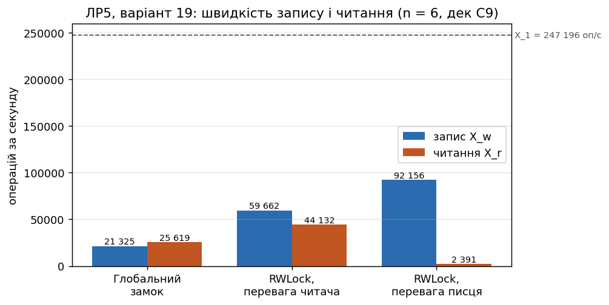

# Звіт: лабораторна робота 5. Потокобезпечна структура даних

**Варіант 19.** Структура С9 — двобічна черга (дек) задач, n = 6 потоків, місткість
1024. Структура з ЛР1–ЛР4 тут не задіяна: робота цілком на боці процесу Python, без
Docker, кластера і бази.

| Параметр варіанта | Значення |
|---|---|
| Структура | С9, двобічна черга (дек) задач |
| Місткість (`Variant_parametr_3`) | 1024 |
| Потоків n | 6 |
| Потоків запису n_w = ⌈n / 2⌉ | 3 (потоки 1, 3, 5) |
| Потоків читання n_r = ⌊n / 2⌋ | 3 (потоки 2, 4, 6) |
| Операція запису | `push` і `pop` до випадково вибраного кінця |
| Операція читання | `peek_front()`, `peek_back()`, `size()` порівну |
| Інваріанти | розмір від 0 до 1024; сусідні вузли посилаються один на одного в обох напрямках |

Запуск: [RUN-LAB5.md](RUN-LAB5.md), детально [HOWTO-LAB5.md](HOWTO-LAB5.md). Сирі дані:
`results/lab5/`, зведені таблиці — [results/lab5/tables.md](results/lab5/tables.md).

## Умови

- Та сама машина, що в ЛР2–ЛР4: Windows 11, 8 логічних ядер, 15,8 ГБ ОЗП. Під час
  прогонів Docker Desktop і кластер зупинені, сторонніх навантажень немає.
- CPython 3.10.11. Байт-код Python виконується під глобальним замком інтерпретатора
  (GIL), тож шість потоків не виконують код одночасно; це визначає майже всі результати
  нижче і сказано тут наперед, а не як виправдання постфактум.
- Кожен прогін: прогрів 1 с, далі D = 10 с вимірювання, і так тричі. У таблицях —
  медіанний прогін конфігурації. Фактична тривалість вимірювання 10,001–10,041 с, і X
  рахується від неї, а не від номінальних 10 с.
- Час — `time.perf_counter`, як у ЛР2. `t_call` береться до захоплення замка, `t_ret` —
  після звільнення, `t_acq` — одразу після захоплення.
- Перцентилі — точна порядкова статистика p_q = τ_(⌈q·N⌉) за всіма тривалостями ролі,
  не оцінка за гістограмою: у кроці 2 це 469 829 значень, у кроці 3 — 1 042 226.

## Крок 1. Стенд

| Що | Де |
|---|---|
| Структура С9 без будь-якої синхронізації | [lab5/structure.py](lab5/structure.py) |
| Глобальний замок і RWLock на `threading.Condition` | [lab5/rwlock.py](lab5/rwlock.py) |
| Стенд: потоки, вимірювання, перцентили, інваріанти | [lab5/bench.py](lab5/bench.py) |
| Прогони кроків 2–5 і таблиці 1–6 | [scripts/lab5_run.py](scripts/lab5_run.py) |
| Перевірка, що читання не змінює структуру | [scripts/lab5_readonly_check.py](scripts/lab5_readonly_check.py) |
| Дослід про хвіст тривалості | [scripts/lab5_switch.py](scripts/lab5_switch.py) |
| Діаграми | [scripts/lab5_charts.py](scripts/lab5_charts.py) |

**Готових потокобезпечних колекцій немає.** Дек — власний двозвʼязний список вузлів
(`Node` з `__slots__`), а не `collections.deque`, не `queue.Queue` і не список Python.
Сама структура не знає про синхронізацію зовсім: замок накладає стенд, тому той самий
код структури працює і в кроці 2, і в кроці 3, і різниця в числах не може походити від
різних реалізацій деку.

**Операція запису.** Вид операції (`push` або `pop`) і кінець (початок або хвіст)
готуються в потоці до виклику: з одного виклику `getrandbits(2)` беруться два біти —
один на вид операції, другий на кінець. `push` на повному деку нічого не змінює і
рахується відмовою, `pop` на порожньому повертає `None`. Через це розмір деку робить
випадкове блукання в межах 0…1024 і за 10 с доходить до межі місткості — межа
перевіряється не на словах.

**Операція читання** — `peek_front()`, `peek_back()` і `size()` строго по колу, тобто
рівно по третині кожної.

**Що друкує стенд після прогону:** кількість операцій кожного потоку, X_w, X_r, p50 і
p99 тривалості кожної ролі, найбільший t_wait запису, w_w і w_r, і результат перевірки
інваріантів.

### Таблиця 1. Стенд

| n | n_w | n_r | Мова і версія | Логічних ядер | X_1, оп/с | Інваріанти після прогонів кроків 2 і 3 |
|---|---|---|---|---|---|---|
| 6 | 3 | 3 | Python 3.10.11 (CPython) | 8 | 247 196 | виконані в усіх прогонах |

X_1 — один потік, що по черзі виконує 3 записи і 3 читання (пропорція n_w : n_r) під тим
самим замком. У таблиці стоїть значення під глобальним замком; під RWLock той самий
однопотоковий прогін дає **102 095 оп/с**, тож у кроці 4 кожне S(n) рахується від X_1
свого способу синхронізації.

## Крок 2. Глобальний замок

Кожна операція — і запис, і читання — захоплює той самий `threading.Lock` на весь час
роботи зі структурою. Умовні змінні не потрібні: операцій, що чекають на порожній чи
повний дек, у С9 немає — `pop` на порожньому повертає `None` одразу.

### Таблиця 2. Глобальний замок

| Роль | Операцій за D | X, оп/с | p50, мкс | p99, мкс | Найбільший t_wait, мс | w | cv | t_cs, мкс |
|---|---|---|---|---|---|---|---|---|
| Запис | 213 425 | 21 325 | 14,00 | 953,70 | 3,119 | 0,8880 | 0,0317 | 1,904 |
| Читання | 256 404 | 25 619 | 10,40 | 900,10 | 4,713 | 0,9127 | 0,0151 | 0,537 |
| Разом | 469 829 | 46 944 | 12,00 | 924,70 | 4,713 | 0,9003 | 0,0944 | 1,220 |

`t_cs` зміряний окремим однопотоковим прогоном без конкуренції: 1,56–1,64 млн операцій
кожної ролі, `t_cs = t_rel − t_acq`, де `t_rel` узятий останньою дією перед
звільненням. Три прогони дали t_cs,w 1,821–1,929 мкс і t_cs,r 0,519–0,544 мкс.

```
t̄_cs = (n_w · t_cs,w + n_r · t_cs,r) / n = (3 · 1,904 + 3 · 0,537) / 6 = 1,220 мкс
1 / t̄_cs = 819 378 оп/с
```

**Читання коштує у 3,5 раза менше за запис** під замком (0,537 проти 1,904 мкс): запис
створює або вилучає вузол і переставляє чотири посилання, читання повертає одне поле.
Саме тому під глобальним замком читачі встигають більше за писців (25 619 проти
21 325 оп/с) — черга до замка одна й та сама, але кожне читання звільняє його швидше.

## Крок 3. RWLock на `threading.Condition`

Запис захоплює замок у режимі запису, читання — у режимі читання
([lab5/rwlock.py](lab5/rwlock.py)). Використані лише мʼютекс і умовна змінна.

**Політика основного прогону — перевага читача.** Читач заходить, щойно немає активного
писця, навіть якщо писці вже стоять у черзі; читачі, що приходять один за одним,
склеюються в одну групу. Писець заходить, коли немає ні активного писця, ні активних
читачів. Пробудження — `notify_all`, а чекати далі чи ні, кожен потік вирішує сам за
умовою в `while`, тож втрачених пробуджень немає.

Цю політику вибрано основною з двох причин. Перша: вона і є тим, за що беруть RWLock —
читачі не блокують одне одного. Друга: саме за неї має сенс величина `t_wait,max`
запису, яку умова ЛР5 пропонує читати як ознаку голодування писця; за протилежної
політики писець не голодує ніколи, і величина нічого не показує. Протилежну політику
зміряно окремо — нижче, у розділі «Перевага писця».

**Читання не змінює структуру** ([scripts/lab5_readonly_check.py](scripts/lab5_readonly_check.py),
`results/lab5/readonly_check.json`), перевірено двічі:

| Перевірка | Що робилось | Результат |
|---|---|---|
| Статична | тіла `peek_front`, `peek_back`, `size` розібрані в дерево розбору; шукались присвоєння в атрибут або елемент, `del` і виклики будь-яких методів, крім читальних | нічого не знайдено |
| Динамічна, один потік | знімок структури (розмір, обидва кінці, весь ланцюг вузлів разом із `prev` і `next`) порівняний до і після 200 000 читань на деку з 512 вузлів | знімок не змінився |
| Динамічна, 3 потоки під RWLock | те саме, 70 191 читання з трьох потоків одночасно | знімок не змінився, інваріанти виконані |

Статична перевірка важлива тим, що стосується всього коду методу, а не того, що
трапилось у конкретному прогоні.

### Таблиця 3. RWLock

| Роль | Операцій за D | X, оп/с | p50, мкс | p99, мкс | Найбільший t_wait, мс | w | cv |
|---|---|---|---|---|---|---|---|
| Запис | 599 084 | 59 662 | 7,00 | 19,10 | 471,864 | 0,7285 | 0,1611 |
| Читання | 443 142 | 44 132 | 5,50 | 38,00 | 328,360 | 0,8261 | 0,1043 |
| Разом | 1 042 226 | 103 794 | 6,60 | 22,80 | 471,864 | 0,7773 | 0,2085 |

### Таблиця 4. Операції потоків за D секунд

| Потік | Роль | Глобальний замок | RWLock |
|---|---|---|---|
| 1 | запис | 69 592 | 244 815 |
| 2 | читання | 84 810 | 160 838 |
| 3 | запис | 74 333 | 172 028 |
| 4 | читання | 87 266 | 126 097 |
| 5 | запис | 69 500 | 182 241 |
| 6 | читання | 84 328 | 156 207 |

Під глобальним замком потоки однієї ролі майже не відрізняються (cv 0,0317 і 0,0151),
під RWLock розбіг доходить до 1,4 раза між писцями (244 815 і 172 028) — до цього
повертається крок 5.


## Крок 4. Метрики прискорення

### Таблиця 5. Метрики прискорення

| Метрика | Формула | Значення |
|---|---|---|
| S(n), глобальний замок | X(G) / X_1 | 0,190 |
| E(n), глобальний замок | S(n) / n | 0,032 |
| S(n), RWLock | X(RW) / X_1 | 1,017 |
| E(n), RWLock | S(n) / n | 0,169 |
| S_w | X_w(RW) / X_w(G) | 2,798 |
| S_r | X_r(RW) / X_r(G) | 1,723 |
| S_Σ | X(RW) / X(G) | 2,211 |
| ρ, завантаженість глобального замка | X(G) · t̄_cs | 0,057 |

**S(n) < 1 для обох замків, і це не дефект стенду.** Шість потоків під глобальним
замком дають 0,190 того, що дає один потік, тобто стенд із потоками у 5,3 раза
повільніший за однопотоковий. Під RWLock шість потоків дають рівно стільки ж, скільки
один (1,017). Причина названа в умовах: байт-код CPython виконується під GIL, тож
додавання потоків не може збільшити кількості виконаного коду за секунду — воно лише
додає витрат на синхронізацію. E(n) 0,032 і 0,169 — це та сама річ у частках
ідеального прискорення.

**Порівняння X(G) з межею 1 / t̄_cs — головне число кроку.**

```
X(G) = 46 944 оп/с        1 / t̄_cs = 819 378 оп/с        X(G) / (1 / t̄_cs) = 0,057
```

Виміряна пропускна здатність у **17,5 раза нижча** за межу одного замка, і
ρ = 0,057 означає, що замок тримається лише 5,7 % часу — 94 % часу він вільний.
Водночас потоки звітують w ≈ 0,90, тобто проводять в очікуванні замка 90 % свого часу.
Ці два числа суперечать одне одному лише на перший погляд: `t_wait = t_acq − t_call`
міряє не той час, коли замок тримає хтось інший, а той, коли потік ще не продовжив
виконання. Потік, приспаний на мʼютексі, мусить дочекатися і пробудження
планувальником, і GIL. Тому межа 1 / t̄_cs тут не досягається навіть близько: вузьке
місце — не критична секція, а ціна приспати і пробудити потік.

Що це саме так, видно з двох чисел. По-перше, p50 тривалості операції під глобальним
замком 12,00 мкс при t̄_cs = 1,22 мкс: 10 з 12 мкс типової операції йде не на роботу зі
структурою. По-друге, хвіст p99 ≈ 0,9 мс не залежить від інтервалу перемикання потоків
CPython — окремий дослід ([scripts/lab5_switch.py](scripts/lab5_switch.py), по три
прогони на значення):

| `sys.setswitchinterval` | X, оп/с | p50, мкс | p99, мкс |
|---|---|---|---|
| 5,0 мс (за замовчуванням) | 46 605 | 12,1 | 941,7 |
| 1,0 мс | 45 217 | 12,4 | 938,7 |
| 0,2 мс | 34 378 | 53,8 | 905,8 |

Гіпотеза «хвіст створює інтервал перемикання потоків» дослідом **відкинута**: інтервал
змінено у 25 разів, а p99 лишилось у межах 906–942 мкс. Отже 0,9 мс — це затримка
пробудження приспаного потоку планувальником системи, а не квант GIL. Побічно видно й
те, що дрібнити інтервал шкідливо: на 0,2 мс пропускна здатність падає на чверть, а p50
зростає вчетверо через зайві перемикання.



## Крок 5. Порівняння доступу до даних

### Таблиця 6. Порівняння доступу до даних

| Показник | Глобальний замок: запис | Глобальний замок: читання | RWLock: запис | RWLock: читання | RW / G: запис | RW / G: читання |
|---|---|---|---|---|---|---|
| X, оп/с | 21 325 | 25 619 | 59 662 | 44 132 | 2,798 | 1,723 |
| x, на один потік ролі, оп/с | 7 108 | 8 540 | 19 887 | 14 711 | 2,798 | 1,723 |
| p50, мкс | 14,00 | 10,40 | 7,00 | 5,50 | 0,500 | 0,529 |
| p99, мкс | 953,70 | 900,10 | 19,10 | 38,00 | 0,020 | 0,042 |
| h = p99 / p50 | 68,12 | 86,55 | 2,73 | 6,91 | 0,040 | 0,080 |
| Найбільший t_wait, мс | 3,119 | 4,713 | 471,864 | 328,360 | 151,282 | 69,667 |
| w | 0,8880 | 0,9127 | 0,7285 | 0,8261 | 0,820 | 0,905 |
| cv | 0,0317 | 0,0151 | 0,1611 | 0,1043 | 5,079 | 6,927 |
| φ, частка ролі в усіх операціях | 0,4543 | 0,5457 | 0,5748 | 0,4252 | 1,265 | 0,779 |

**Для якої ролі швидкість зросла.** Для обох: запис у 2,798 раза, читання у 1,723 раза.
Жодна роль від заміни замка не втратила швидкості. Але зросли вони по-різному, і
сильніше зросла та роль, якій RWLock теоретично не має допомагати ніяк — запис, бо
запис і далі виключний. Через це φ запису піднялась з 0,4543 до 0,5748: під RWLock
більшість операцій стенду стали записами, хоча потоків кожної ролі порівну.

**З яким полем таблиці 6 це пов'язано.** З трьома, і вони вказують у різні боки.

- **Частка очікування w** впала в обох ролей: 0,8880 → 0,7285 у запису і
  0,9127 → 0,8261 у читання. Це безпосередня причина зростання X: частка часу, яку
  потік витрачає на роботу замість очікування, збільшилась.
- **Хвіст тривалості h** обвалився сильніше за все інше: 68,12 → 2,73 у запису і
  86,55 → 6,91 у читання, бо p99 впало з 954 до 19,1 мкс і з 900 до 38,0 мкс. Під
  глобальним замком типова операція тривала 12 мкс, а кожна сота — майже мілісекунду;
  під RWLock розподіл став вузьким. Це й є механізм виграшу: читач, що приходить, коли
  читають інші, не засинає взагалі, тож зникає саме та частина операцій, що коштувала
  пробудження. Писцям це дає менше суперників у черзі, і вони теж рідше засинають — ось
  чому виграш запису навіть більший.
- **Рівномірність cv** погіршилась у 5,079 раза в запису і 6,927 раза в читання, а
  найбільше очікування однієї операції зросло з 3,1–4,7 мс до 328–472 мс, тобто до
  3,3–4,7 % усього вимірювання. Це ціна виграшу: RWLock віддає чесність в обмін на
  пропускну здатність. Потік, що вже отримав процесор, проходить замок без блокування і
  накручує операції (писець 1 — 244 815 операцій), поки приспаний потік чекає своєї
  черги (писець 3 — 172 028). Під глобальним замком такого немає: `threading.Lock`
  роздає замок приблизно по черзі, і cv лишається 0,015–0,032.

**Голодування писця за t_wait,max.** 471,9 мс при D = 10 с — це 4,7 % вимірювання, тобто
за політики переваги читача писець таки чекає довго, але не половину прогону: групи
читачів у CPython не склеюються в суцільний потік, бо читач між операціями відпускає
замок і GIL, і писець встигає пролізти. Три прогони дали 374,6, 360,7 і 471,9 мс —
величина стабільна за порядком.


### Перевага писця: та сама реалізація, протилежна політика

Прогін із `policy="writer"` (читач стає в чергу, якщо хоч один писець уже чекає):

| Роль | Операцій за D | X, оп/с | p50, мкс | p99, мкс | Найбільший t_wait, мс | w | cv |
|---|---|---|---|---|---|---|---|
| Запис | 922 756 | 92 156 | 7,00 | 18,80 | 346,656 | 0,6580 | 0,0950 |
| Читання | 23 941 | 2 391 | 5,60 | 18,40 | 1 672,846 | 0,8514 | 0,3023 |
| Разом | 946 697 | 94 547 | 7,00 | 18,80 | 1 672,846 | 0,7547 | 0,9585 |

**Тут голодують читачі.** Половина потоків стенду пише без пауз, тож писець у черзі є
майже завжди, і читач майже завжди стає за ним: X_r падає з 44 132 до 2 391 оп/с, тобто
у 18,5 раза, найбільше очікування однієї операції читання доходить до 1 672,8 мс — 17 %
усього вимірювання, а cv стенду загалом піднімається до 0,9585. Сумарна X при цьому
майже не змінюється: 94 547 проти 103 794, тобто на 8,9 % нижча — майже в межах розкиду
між прогонами (6,6–8,3 %). Саме це робить приклад показовим: за самою лише сумарною
пропускною здатністю голодування цілої ролі не видно, а за X_r, `t_wait,max` і cv —
видно відразу.

Висновок про політику: під навантаженням, де половина операцій це записи, «RWLock»
перестає бути компромісом і стає вибором, кого саме приспати. Жодна з двох політик не
дає обом ролям і швидкості, і чесності.

## Інваріанти структури

Перевіряються після кожного прогону під замком: розмір у межах 0…1024; прохід уперед і
прохід назад дають однакову кількість вузлів, рівну розмірові; `node.next.prev is node`
і `node.prev.next is node` для кожного вузла; у голови немає `prev`, у хвоста немає
`next`; покладено мінус вийнято дорівнює розмірові.

| Прогін | Розмір на кінець | Найбільший за прогін | Покладено | Вийнято | Відмов push через повноту | pop на порожньому | Інваріанти |
|---|---|---|---|---|---|---|---|
| крок 2, глобальний замок | 1002 | 1024 з 1024 | 122 590 | 121 588 | 23 | 402 | виконані |
| крок 3, RWLock, перевага читача | 990 | 1024 з 1024 | 341 667 | 340 677 | 1 322 | 369 | виконані |
| RWLock, перевага писця | 650 | 1024 з 1024 | 521 766 | 521 116 | 2 095 | 210 | виконані |
| контроль, глобальний замок | 1 | 3 з 1024 | 122 327 | 122 326 | 0 | 0 | виконані |
| контроль, RWLock | 1 | 3 з 1024 | 337 546 | 337 545 | 0 | 0 | виконані |

Межа місткості досягнута в усіх трьох основних прогонах, і саме там відмови `push`
(23, 1 322 і 2 095) показують, що інваріант «розмір не більший за 1024» тримається не
випадково, а перевіряється самою структурою.

## Розкид між прогонами

| Конфігурація | X прогонів, оп/с | Медіана | Розмах, % |
|---|---|---|---|
| глобальний замок | 45 859, 47 743, 46 944 | 46 944 | 4,0 |
| RWLock, перевага читача | 106 803, 98 139, 103 794 | 103 794 | 8,3 |
| RWLock, перевага писця | 94 840, 94 547, 88 566 | 94 547 | 6,6 |
| глобальний замок, контроль push+pop | 45 484, 46 749, 45 823 | 45 823 | 2,8 |
| RWLock, контроль push+pop | 104 807, 105 771, 108 940 | 105 771 | 3,9 |
| X_1, глобальний замок | 247 196, 248 292, 241 411 | 247 196 | 2,8 |
| X_1, RWLock | 104 421, 102 095, 100 119 | 102 095 | 4,2 |

Розмах 2,8–8,3 % задає, які різниці в таблицях взагалі варто читати. S_w = 2,798,
S_r = 1,723 і S_Σ = 2,211 лежать далеко за межами розкиду, тож це результат, а не шум.
Різниця між сумарними X двох політик RWLock (103 794 і 94 547, тобто 8,9 %) лежить майже
на межі розкиду, і тому в розділі про перевагу писця висновок зроблено не з неї, а з
X_r, t_wait,max і cv, де різниця кратна.

## Відхилення від умови і методичні рішення

| Що | Чому |
|---|---|
| Операція запису розуміється як «`push` або `pop`, вид і кінець вибираються випадково, порівну» | умова С9 каже «push і pop до випадково вибраного кінця», без формули С1 і С4 «за яким той самий потік виконує take». За строгого чергування розмір деку не відходить від нуля (найбільший за прогін 3 вузли), і ні місткість 1024, ні ланцюг посилань не перевіряються нічим. Обидва читання зміряні, контрольна серія — нижче |
| Основна політика RWLock — перевага читача, перевага писця зміряна окремо | за переваги писця величина `t_wait,max` запису, якою умова пропонує шукати голодування писця, тотожно мала: писець не голодує за побудовою. Обидві політики в одному класі, різниця — в умові очікування читача |
| «Медіана трьох прогонів» узята як медіанний **прогін** за сумарною X, а не як медіана кожного числа окремо | медіани окремих величин належали б різним прогонам, і рядок таблиці перестав би описувати одне вимірювання; всі три прогони наведені в розділі про розкид |
| X_1 зміряна двічі, під кожним замком | умова каже «під тим самим замком», а один потік під RWLock працює у 2,4 раза повільніше за один потік під мʼютексом (102 095 проти 247 196 оп/с) через дорожчий шлях захоплення. Рахувати S(n) для RWLock від X_1 мʼютекса означало б приписати RWLock чужу втрату |
| Дек перед прогоном не заповнюється | умова вимагає заповнення половиною простору ключів для С2, С3, С7, С8 і С10; С9 серед них немає, і дек стартує порожнім |
| D береться фактичний (10,001–10,041 с), а не номінальні 10 с | різниця до 0,4 % прямо входила б у X; простіше зміряти, ніж округлити |
| `numpy` використовується тільки для сортування масиву тривалостей | на 1,04 млн операцій список об'єктів `float` Python коштував би сотні мегабайтів; тривалості зберігаються в `array('d')`, і сортування йде по тому самому буферу без копії в об'єкти. Жодна величина через `numpy` не обчислюється — перцентилі беруться порядковою статистикою |
| Одна-дві операції на потік можуть потрапити на межу прогріву і вимірювання | ознака вимірювання читається на початку витка циклу, тож операція, що почалась у прогріві, записується; на 470 тис. – 1,04 млн операцій це частки відсотка |

### Контрольна серія: строге чергування push і pop

| Замок | X_w, оп/с | X_r, оп/с | X, оп/с | Найбільший розмір деку | w запису | w читання |
|---|---|---|---|---|---|---|
| глобальний | 21 163 | 24 660 | 45 823 | 3 | 0,8874 | 0,9142 |
| RWLock | 60 028 | 45 742 | 105 771 | 3 | 0,7384 | 0,8280 |

Проти основних прогонів (46 944 і 103 794 оп/с) сумарна X відрізняється на 2,4 % і 1,9 %,
тобто в межах розкиду між прогонами, а X_w, X_r і w збігаються до тих самих часток
відсотка. Отже вибір читання операції запису ні на одне число таблиць 2, 3, 5 і 6 не
впливає — крім найбільшого розміру деку, який за строгого чергування лишається 3 вузли, і
саме тому основним узято інше читання.

## Що з цього випливає

- **Дек С9 потокобезпечний за обох способів синхронізації.** Інваріанти виконані в усіх
  прогонах: розмір не вийшов за 1024 (межа досягнута, 23–2 095 відмов `push`), прохід
  уперед і назад завжди давав однакову кількість вузлів, кожна пара сусідів посилалась
  одна на одну.
- **Глобальний замок не впирається в себе.** ρ = 0,057: замок вільний 94 % часу, а
  виміряна X у 17,5 раза нижча за межу 1 / t̄_cs = 819 378 оп/с. Вузьке місце — ціна
  приспати і пробудити потік, і хвіст p99 ≈ 0,9 мс не залежить від інтервалу перемикання
  потоків CPython.
- **Заміна на RWLock виграє обом ролям**: S_w = 2,798, S_r = 1,723, S_Σ = 2,211. Виграш
  дає не паралельне читання (під GIL його немає), а те, що читач серед читачів не
  засинає: p99 запису впало з 954 до 19,1 мкс, читання — з 900 до 38,0 мкс.
- **Платою є чесність.** cv зріс у 5,1 і 6,9 раза, найбільше очікування однієї операції —
  з 3,1–4,7 мс до 328–472 мс. За протилежної політики та сама плата переноситься на
  читачів, і вже вони втрачають швидкість у 18,5 раза при майже незмінній сумарній X.
- **Потоки в CPython не прискорюють цю структуру взагалі**: S(n) = 0,190 під глобальним
  замком і 1,017 під RWLock. Один потік без конкуренції дає 247 196 оп/с — більше за
  будь-який прогін на шести потоках. Для такої структури на Python потоки мають сенс як
  спосіб сумістити роботу з очікуванням введення-виведення, а не як спосіб порахувати
  швидше.

## Використання генеративних моделей

**Оформлення тексту.** Структура розділів, зведення чисел у таблиці.

**Помилки і помилкові гіпотези, знайдені під час роботи:**

- Першою політикою RWLock була перевага писця — як «правильна за замовчуванням, бо не
  дає голодувати писцеві». Прогін показав протилежне: при трьох писцях без пауз
  `_waiting_writers` майже ніколи не нуль, і голодувати стали читачі — 2 391 оп/с проти
  44 132 за переваги читача, у 18,5 раза менше. Відношення таблиці 6 для читання
  перетворювались на опис майже зупиненої ролі, а не на порівняння двох способів
  синхронізації. Основною політикою стала перевага читача, а перевага писця лишилась
  окремим прогоном, який тепер і показує, що саме виявляє `t_wait,max`.
- Хвіст p99 ≈ 0,9 мс спершу приписано інтервалу перемикання потоків CPython (5 мс за
  замовчуванням). Дослід на трьох значеннях інтервалу (5; 1; 0,2 мс по три прогони) цю
  гіпотезу відкинув: p99 лишилось 906–942 мкс. У звіті стоїть той висновок, що
  витримав перевірку, — затримка пробудження потоку планувальником системи.
- Перше читання операції запису («`push`, за яким той самий потік виконує `pop`», як у
  С1 і С4) лишало дек із трьома вузлами за весь прогін, тож інваріант про межу місткості
  не перевірявся нічим. Обидва читання зміряні, різниця 1,9–2,4 % наведена в розділі
  відхилень.
- Перцентилі спершу рахувались по списку Python з усіх тривалостей; на 1,04 млн операцій
  це давало сотні мегабайтів під об'єкти `float`. Тривалості перенесені в `array('d')`.
- Структура спершу містила замок у собі, і крок 3 вимагав би другої реалізації деку.
  Замок перенесений у стенд: різниця між кроками 2 і 3 тепер не може походити від різних
  структур.
