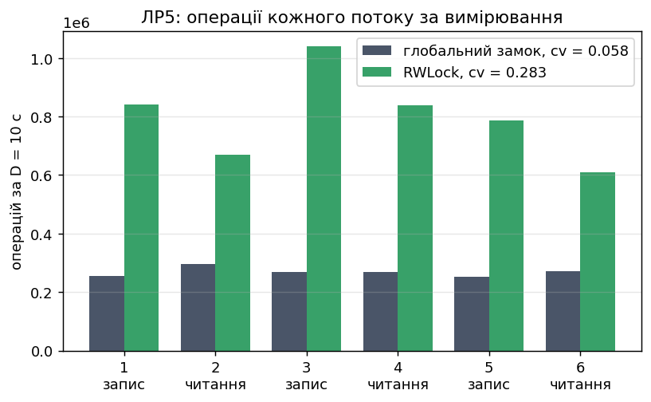
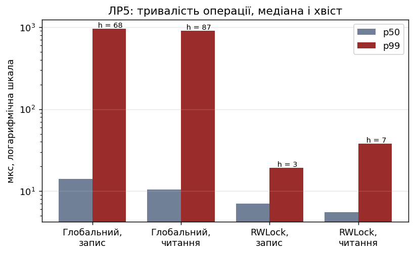

# Звіт: лабораторна робота 5. Потокобезпечна структура даних

**Варіант 19.** Структура С9 — двобічна черга (дек) задач, n = 6 потоків, місткість
1024. Сервіс ЛР1–ЛР4 тут не задіяний: робота цілком у межах одного процесу Python, без
Docker, кластера і бази.

| Параметр варіанта | Значення |
|---|---|
| Структура | С9, двобічна черга (дек) задач |
| Місткість (`Variant_parametr_3`) | 1024 |
| Потоків n | 6 |
| Потоків запису n_w = ⌈n / 2⌉ | 3 (потоки 1, 3, 5) |
| Потоків читання n_r = ⌊n / 2⌋ | 3 (потоки 2, 4, 6) |
| Операція запису | `push` і `pop` до випадково вибраного кінця |
| Операція читання | `peek_front()`, `peek_back()`, `size()` порівну |
| Інваріанти | розмір від 0 до 1024; сусідні вузли посилаються один на одного в обох напрямках |

Запуск: [RUN-LAB5.md](RUN-LAB5.md), детально [HOWTO-LAB5.md](HOWTO-LAB5.md). Сирі дані:
`results/lab5/`, зведені таблиці — [results/lab5/tables.md](results/lab5/tables.md),
самоперевірка — [results/lab5/checks.md](results/lab5/checks.md).

## Умови

- Та сама машина, що в ЛР2–ЛР4: Windows 11, 8 логічних ядер, 15,8 ГБ ОЗП.
- **Сторонні навантаження.** Docker Desktop і кластер kind з ЛР3–ЛР4 під час прогонів не
  працювали: останній запис журналів Docker Desktop (`%LOCALAPPDATA%\Docker\log`) датований
  12.11.2026, а прогони ЛР5 зняті 19.11.2026 з 00:21 до 00:31. Інші програми користувача
  (середовище розробки, браузер) не закривались; їхнє навантаження не міряне.
- CPython 3.10.11. Байт-код Python виконується під глобальним замком інтерпретатора
  (GIL), тож шість потоків не виконують код одночасно. Від цього залежить більшість
  результатів нижче.
- Кожен прогін: прогрів 1 с, далі D = 10 с вимірювання, і так тричі. У таблицях —
  медіанний прогін конфігурації. Фактична тривалість вимірювання 10,001–10,041 с, і X
  рахується від неї, а не від номінальних 10 с.
- Час — `time.perf_counter`. Його крок на цій машині 100 нс (`time.get_clock_info` і
  найменші ненульові різниці двох викликів поспіль), тому p50 і p99 подано з одним знаком
  після коми в мікросекундах. Один виклик таймера коштує ≈ 54 нс
  ([results/lab5/checks.md](results/lab5/checks.md)).
- `t_call` береться до захоплення замка, `t_ret` — після звільнення, `t_acq` — одразу
  після захоплення.
- Перцентилі — точна порядкова статистика p_q = τ_(⌈q·N⌉) за всіма тривалостями ролі,
  не оцінка за гістограмою: у кроці 2 це 469 829 значень, у кроці 3 — 1 042 226.
  Номер ⌈q·N⌉ обчислюється в цілих числах.

## Крок 1. Стенд

| Що | Де |
|---|---|
| Структура С9 без будь-якої синхронізації | [lab5/structure.py](lab5/structure.py) |
| Глобальний замок і RWLock на `threading.Condition` | [lab5/rwlock.py](lab5/rwlock.py) |
| Стенд: потоки, вимірювання, перцентилі, інваріанти | [lab5/bench.py](lab5/bench.py) |
| Прогони кроків 2–5 і таблиці 1–6 | [scripts/lab5_run.py](scripts/lab5_run.py) |
| Перевірка, що читання не змінює структуру | [scripts/lab5_readonly_check.py](scripts/lab5_readonly_check.py) |
| Самоперевірка структури, замків і формул | [scripts/lab5_selfcheck.py](scripts/lab5_selfcheck.py) |
| Дослід про хвіст тривалості | [scripts/lab5_switch.py](scripts/lab5_switch.py) |
| Діаграми | [scripts/lab5_charts.py](scripts/lab5_charts.py) |

**Готових потокобезпечних колекцій немає.** Дек — власний двозвʼязний список вузлів
(`Node` з `__slots__`), а не `collections.deque`, не `queue.Queue` і не список Python.
Сама структура синхронізації не містить: замок накладає стенд, тому той самий код
структури працює і в кроці 2, і в кроці 3. Стенд і скрипти використовують лише
стандартну бібліотеку Python; matplotlib потрібен тільки для діаграм.

**Операція запису.** Вид операції (`push` або `pop`) і кінець (початок або хвіст)
готуються в потоці до виклику: з одного виклику `getrandbits(2)` беруться два біти —
один на вид операції, другий на кінець. `push` на повному деку нічого не змінює і
рахується відмовою, `pop` на порожньому повертає `None`. Розмір деку робить випадкове
блукання в межах 0…1024 і в кожному з дев'яти прогонів кроків 2–3 і переваги писця
доходить до межі місткості.

**Операція читання** — `peek_front()`, `peek_back()` і `size()` строго по колу, тобто
рівно по третині кожної.

Обидві частки перевірені окремим прогоном із лічильниками викликів у самій структурі:
`push` 0,4994 усіх записів, початок деку 0,5013 (допуск ±0,0020, тобто 4σ біноміальної
похибки), три операції читання — рівно по 0,33333; кількість операцій, яку порахували
потоки, дорівнює кількості викликів структури ([results/lab5/checks.md](results/lab5/checks.md)).

**Що друкує стенд після прогону:** кількість операцій кожного потоку, X_w, X_r, p50 і
p99 тривалості кожної ролі, найбільший t_wait запису, w_w і w_r, і результат перевірки
інваріантів. Спосіб синхронізації вибирається ключем `--lock`, X_1 вимірюється режимом
`single`.

### Таблиця 1. Стенд

| n | n_w | n_r | Мова і версія | Логічних ядер | X_1, оп/с | Інваріанти після прогонів кроків 2 і 3 |
|---|---|---|---|---|---|---|
| 6 | 3 | 3 | Python 3.10.11 (CPython) | 8 | 247 196 | виконані в усіх 6 прогонах |

X_1 — один потік, що по черзі виконує 3 записи і 3 читання (пропорція n_w : n_r) під тим
самим замком. У таблиці стоїть значення під глобальним замком; під RWLock той самий
однопотоковий прогін дає **102 095 оп/с**, тож у кроці 4 кожне S(n) рахується від X_1
свого способу синхронізації. Інваріанти виконані не лише в шести прогонах кроків 2 і 3,
а в усіх 24 прогонах роботи.

## Крок 2. Глобальний замок

Кожна операція — і запис, і читання — захоплює той самий `threading.Lock` на весь час
роботи зі структурою. Умовні змінні не потрібні: операцій, що чекають на порожній чи
повний дек, у С9 немає — `pop` на порожньому повертає `None` одразу.

### Таблиця 2. Глобальний замок

| Роль | Операцій за D | X, оп/с | p50, мкс | p99, мкс | Найбільший t_wait, мс | w | cv | t_cs, мкс |
|---|---|---|---|---|---|---|---|---|
| Запис | 213 425 | 21 325 | 14,0 | 953,7 | 3,119 | 0,8880 | 0,0317 | 1,904 |
| Читання | 256 404 | 25 619 | 10,4 | 900,1 | 4,713 | 0,9127 | 0,0151 | 0,537 |
| Разом | 469 829 | 46 944 | 12,0 | 924,7 | 4,713 | 0,9003 | 0,0944 | 1,220 |

У рядку «Разом» p50 і p99 рахуються по всіх операціях обох ролей, w — як
Σ t_wait / (n · D), cv — по всіх шести потоках, t_cs — це t̄_cs.

`t_cs` зміряний окремим однопотоковим прогоном без конкуренції: 1,56–1,64 млн операцій
кожної ролі, `t_cs = t_rel − t_acq`, де `t_rel` узятий останньою дією перед звільненням.
Три прогони дали t_cs,w 1,821–1,929 мкс і t_cs,r 0,519–0,544 мкс. У виміряний відрізок
входить один виклик таймера (≈ 54 нс), тобто близько 10 % t_cs,r і 3 % t_cs,w; без
нього t̄_cs і ρ були б трохи меншими, і висновки кроку 4 від цього лише посилились би.

```
t̄_cs = (n_w · t_cs,w + n_r · t_cs,r) / n = (3 · 1,904 + 3 · 0,537) / 6 = 1,220 мкс
1 / t̄_cs = 819 378 оп/с
```

**Читання тримає замок у 3,5 раза коротше за запис** (0,537 проти 1,904 мкс): запис
створює або вилучає вузол, оновлює посилання сусідів і лічильники, читання повертає одне
поле. Під глобальним замком читачі встигають більше за писців (25 619 проти
21 325 оп/с) при однаковій кількості потоків.

## Крок 3. RWLock на `threading.Condition`

Запис захоплює замок у режимі запису, читання — у режимі читання
([lab5/rwlock.py](lab5/rwlock.py)). Використані лише мʼютекс і умовна змінна.

**Політика основного прогону — перевага читача.** Читач заходить, щойно немає активного
писця, навіть якщо писці вже чекають; кілька читачів тримають замок одночасно. Писець
заходить, коли немає ні активного писця, ні активних читачів.

**Друга політика — перевага писця** — зміряна окремим прогоном (розділ «Перевага
писця»): новий читач стає в чергу, якщо хоча б один писець уже чекає.

**Спільне для обох.** Пробудження через `notify_all`, а чекати далі чи ні, кожен потік
вирішує сам за умовою в `while`, тож втрачених пробуджень немає. Черги FIFO серед тих,
хто чекає, немає: заходить той, хто першим захопить внутрішній мʼютекс умовної змінної.
Потік, що звільнив замок і одразу просить його знову, ще тримає GIL і тому зазвичай
встигає раніше за розбуджених. Самоперевірка це показує: коли критична секція триває
0,3 мс (з `time.sleep` усередині), за 1,5 с читачі входять лише раз на початку
(3 операції читання) за **обох** політик — писці, що звільняють і одразу знову
захоплюють замок, не лишають їм вікна.

**Чому основною взято перевагу читача.** За переваги писця при трьох писцях без пауз
писець у черзі є майже завжди, і читачі майже не отримують доступу: 2 391 оп/с проти
44 132 за переваги читача (розділ «Перевага писця»). Порівняння двох способів
синхронізації в таблиці 6 тоді описувало б не RWLock, а майже зупинену роль.

**Що замок робить те, що обіцяє** — перевірено
([scripts/lab5_selfcheck.py](scripts/lab5_selfcheck.py)):

| Перевірка | Очікувано | Фактично |
|---|---|---|
| Взаємне виключення, глобальний замок; 3 писці і 3 читачі зі `sleep` 0,3 мс усередині | одночасно не більше одного потоку | найбільше одночасно 1, порушень 0 |
| RWLock, перевага читача, той самий дослід | писець сам; читачі разом | писців одночасно 1, читачів до 3, порушень 0 |
| RWLock, перевага писця, той самий дослід | те саме | писців одночасно 1, читачів до 3, порушень 0 |
| Порядок входу, перевага читача: R1 тримає, W чекає, приходить R2 | R2 заходить раніше за W | R2 → W |
| Те саме, перевага писця | W заходить раніше за R2 | W → R2 |

**Читання не змінює структуру** ([scripts/lab5_readonly_check.py](scripts/lab5_readonly_check.py),
`results/lab5/readonly_check.json`):

| Перевірка | Що робилось | Результат |
|---|---|---|
| Статична | тіла `peek_front`, `peek_back`, `size` розібрані в дерево розбору; шукались присвоєння в атрибут або елемент, `del` і виклики будь-яких методів, крім читальних | нічого не знайдено |
| Динамічна, один потік | знімок структури (розмір, обидва кінці, весь ланцюг вузлів разом із `prev` і `next`) порівняний до і після 200 000 читань на деку з 512 вузлів | знімок не змінився |
| Динамічна, 3 потоки під RWLock | те саме, 70 191 читання з трьох потоків одночасно | знімок не змінився, інваріанти виконані |

Статична перевірка стосується всього коду методу, а не лише того, що трапилось у
конкретному прогоні.

### Таблиця 3. RWLock

| Роль | Операцій за D | X, оп/с | p50, мкс | p99, мкс | Найбільший t_wait, мс | w | cv |
|---|---|---|---|---|---|---|---|
| Запис | 599 084 | 59 662 | 7,0 | 19,1 | 471,864 | 0,7285 | 0,1611 |
| Читання | 443 142 | 44 132 | 5,5 | 38,0 | 328,360 | 0,8261 | 0,1043 |
| Разом | 1 042 226 | 103 794 | 6,6 | 22,8 | 471,864 | 0,7773 | 0,2085 |

### Таблиця 4. Операції потоків за D секунд

| Потік | Роль | Глобальний замок | RWLock |
|---|---|---|---|
| 1 | запис | 69 592 | 244 815 |
| 2 | читання | 84 810 | 160 838 |
| 3 | запис | 74 333 | 172 028 |
| 4 | читання | 87 266 | 126 097 |
| 5 | запис | 69 500 | 182 241 |
| 6 | читання | 84 328 | 156 207 |

Під глобальним замком потоки однієї ролі майже не відрізняються (cv 0,0317 і 0,0151),
під RWLock розбіг між писцями доходить до 1,42 раза (244 815 і 172 028).



## Крок 4. Метрики прискорення

### Таблиця 5. Метрики прискорення

| Метрика | Формула | Значення |
|---|---|---|
| S(n), глобальний замок | X(G) / X_1 | 0,190 |
| E(n), глобальний замок | S(n) / n | 0,032 |
| S(n), RWLock | X(RW) / X_1 | 1,017 |
| E(n), RWLock | S(n) / n | 0,169 |
| S_w | X_w(RW) / X_w(G) | 2,798 |
| S_r | X_r(RW) / X_r(G) | 1,723 |
| S_Σ | X(RW) / X(G) | 2,211 |
| ρ, завантаженість глобального замка | X(G) · t̄_cs | 0,057 |

Усі величини таблиць 2–6 незалежно перераховані з сирих прогонів (235 величин у 15
прогонах і `summary.json`): найбільша відносна розбіжність 2,3·10⁻¹⁶, тобто похибка
округлення ([results/lab5/checks.md](results/lab5/checks.md)).

**S(n) < 1 для обох замків.** Шість потоків під глобальним замком дають 0,190 того, що
дає один потік, тобто стенд із потоками у 5,3 раза повільніший за однопотоковий. Під
RWLock шість потоків дають приблизно стільки ж, скільки один (1,017). Під GIL додавання
потоків не збільшує кількості виконаного байт-коду за секунду, а витрати на
синхронізацію додає. E(n) 0,032 і 0,169 — те саме в частках ідеального прискорення.

**Порівняння X(G) з межею 1 / t̄_cs.**

```
X(G) = 46 944 оп/с        1 / t̄_cs = 819 378 оп/с        X(G) / (1 / t̄_cs) = ρ = 0,057
```

Виміряна пропускна здатність у **17,5 раза нижча** за межу одного замка: замок
утримується лише 5,7 % часу. Водночас потоки звітують w ≈ 0,90, тобто 90 % свого часу
перебувають між `t_call` і `t_acq`. Обидва числа разом означають, що більшу частину цього
часу замок вільний, а потік ще не продовжив виконання: `t_wait` охоплює не лише час, поки
замок тримає інший потік, а й час, поки потік чекає на процесор і GIL. Межа 1 / t̄_cs
тому не досягається навіть близько: вузьке місце — не критична секція. Це видно й з
медіани: p50 тривалості операції 12,0 мкс при t̄_cs = 1,22 мкс.

**Звідки хвіст p99 ≈ 0,9 мс.** Перевірено гіпотезу, що його задає інтервал перемикання
потоків CPython (`sys.setswitchinterval`, 5 мс за замовчуванням)
([scripts/lab5_switch.py](scripts/lab5_switch.py), по три прогони на значення,
`results/lab5/switch_interval.json`):

| `sys.setswitchinterval` | X, оп/с | p50, мкс | p99, мкс |
|---|---|---|---|
| 5,0 мс (за замовчуванням) | 46 605 | 12,1 | 941,7 |
| 1,0 мс | 45 217 | 12,4 | 938,7 |
| 0,2 мс | 34 378 | 53,8 | 905,8 |

Гіпотезу **відкинуто**: інтервал змінено у 25 разів, а p99 лишилось у межах
906–942 мкс. Отже хвіст задає не інтервал перемикання CPython; найімовірніше, це затримка
пробудження приспаного потоку планувальником Windows, але прямо вона не міряна. Побічно
видно, що дрібнити інтервал шкідливо: на 0,2 мс X падає на 26 %, а p50 зростає в 4,4 раза.


## Крок 5. Порівняння доступу до даних

### Таблиця 6. Порівняння доступу до даних

| Показник | Глобальний замок: запис | Глобальний замок: читання | RWLock: запис | RWLock: читання | RW / G: запис | RW / G: читання |
|---|---|---|---|---|---|---|
| X, оп/с | 21 325 | 25 619 | 59 662 | 44 132 | 2,798 | 1,723 |
| x, на один потік ролі, оп/с | 7 108 | 8 540 | 19 887 | 14 711 | 2,798 | 1,723 |
| p50, мкс | 14,0 | 10,4 | 7,0 | 5,5 | 0,500 | 0,529 |
| p99, мкс | 953,7 | 900,1 | 19,1 | 38,0 | 0,020 | 0,042 |
| h = p99 / p50 | 68,12 | 86,55 | 2,73 | 6,91 | 0,040 | 0,080 |
| Найбільший t_wait, мс | 3,119 | 4,713 | 471,864 | 328,360 | 151,282 | 69,667 |
| w | 0,8880 | 0,9127 | 0,7285 | 0,8261 | 0,820 | 0,905 |
| cv | 0,0317 | 0,0151 | 0,1611 | 0,1043 | 5,079 | 6,927 |
| φ, частка ролі в усіх операціях | 0,4543 | 0,5457 | 0,5748 | 0,4252 | 1,265 | 0,779 |

**Для якої ролі швидкість зросла, для якої зменшилась.** Зросла для обох: запис у
2,798 раза, читання у 1,723 раза; жодна роль від заміни замка не втратила. Сильніше
зріс запис, хоча запис і під RWLock виключний. Тому φ запису піднялась з 0,4543 до
0,5748: під RWLock більшість операцій стенду стали записами при однаковій кількості
потоків кожної ролі.

**З якими полями таблиці 6 це повʼязано.**

- **Частка очікування w** впала в обох ролей: 0,8880 → 0,7285 у запису і
  0,9127 → 0,8261 у читання. Частка часу потоку, що припадає на саму операцію, зросла,
  і з нею зросла X.
- **Хвіст тривалості h** скоротився найсильніше: 68,12 → 2,73 у запису і 86,55 → 6,91 у
  читання, бо p99 впало з 953,7 до 19,1 мкс і з 900,1 до 38,0 мкс, а p50 — лише вдвічі.
  Під глобальним замком кожна сота операція тривала майже мілісекунду, під RWLock 99 %
  операцій вкладаються в десятки мікросекунд.
- **Рівномірність cv** погіршилась у 5,079 раза в запису і 6,927 раза в читання, а
  найбільше очікування однієї операції зросло з 3,1–4,7 мс до 328–472 мс, тобто до
  3,3–4,7 % усього вимірювання. Очікування стало зосередженим у небагатьох операціях:
  середнє очікування операції запису 36,6 мкс, тоді як 99 % операцій запису тривають не
  довше 19,1 мкс разом з очікуванням. Звідси щонайменше 48,4 % усього часу очікування
  писців припадає на 1 % найдовших операцій; для читання — щонайменше 33,0 % (середнє
  56,2 мкс проти p99 38,0 мкс). Під глобальним замком такої концентрації немає: середнє
  очікування 124,9 і 106,9 мкс, а p99 тривалості близько 0,9 мс.

Отже RWLock виграє в пропускній здатності і в типовій та «99-відсотковій» тривалості
операції ціною рівномірності: окремі потоки і окремі операції чекають набагато довше,
ніж під глобальним замком.

**Голодування писця за t_wait,max.** Найбільше очікування однієї операції запису
471,9 мс при D = 10 с — 4,7 % вимірювання; три прогони дали 374,6, 360,7 і 471,9 мс.
Писця не відкладено на більшу частину прогону, тож голодування в сенсі умови немає, але
окремі операції запису чекають у сотні разів довше, ніж під глобальним замком. Чи це
читачі, чи інші писці, за цими даними не розділити: за переваги писця, де читачі писця,
що чекає, не обганяють, найбільше очікування запису теж 346,7 мс (розділ нижче), отже
довгі очікування писця дає щонайменше і відсутність черги серед писців.



### Перевага писця: та сама реалізація, протилежна політика

Прогін із `policy="writer"` (читач стає в чергу, якщо хоч один писець уже чекає):

| Роль | Операцій за D | X, оп/с | p50, мкс | p99, мкс | Найбільший t_wait, мс | w | cv |
|---|---|---|---|---|---|---|---|
| Запис | 922 756 | 92 156 | 7,0 | 18,8 | 346,656 | 0,6580 | 0,0950 |
| Читання | 23 941 | 2 391 | 5,6 | 18,4 | 1 672,846 | 0,8514 | 0,3023 |
| Разом | 946 697 | 94 547 | 7,0 | 18,8 | 1 672,846 | 0,7547 | 0,9585 |

**Тут майже не отримують доступу читачі.** Половина потоків стенду пише без пауз, тож
писець у черзі є майже завжди, і новий читач стає за ним: X_r падає з 44 132 до
2 391 оп/с, тобто у 18,5 раза, найбільше очікування однієї операції читання доходить до
1 672,8 мс — 17 % вимірювання, cv усього стенду 0,9585. Сумарна X при цьому змінюється
мало: 94 547 проти 103 794, на 8,9 % нижча, що близько до розкиду між прогонами
(6,6–8,3 %). За сумарною X стан ролі читання не видно, а за X_r, `t_wait,max` і cv —
видно відразу.

Найбільше очікування запису і тут 346,7 мс, хоча читачі писця, що вже чекає, не
обганяють (порядок W → R2 перевірено в кроці 3). Довге очікування писця дають інші
писці: черги між ними немає.

Висновок про політику: під навантаженням, де половина операцій — записи, жодна з двох
політик цього RWLock не дає обом ролям і швидкості, і рівномірності.

## Коректність структури

**Інваріанти** перевіряються після кожного прогону, коли потоки вже зупинені: розмір у
межах 0…1024; прохід уперед і прохід назад дають однакову кількість вузлів, рівну
розмірові; `node.next.prev is node` і `node.prev.next is node` для кожного вузла; у голови
немає `prev`, у хвоста немає `next`; покладено мінус вийнято дорівнює розмірові.

| Прогін | Розмір на кінець | Найбільший за прогін | Покладено | Вийнято | Відмов push через повноту | pop на порожньому | Інваріанти |
|---|---|---|---|---|---|---|---|
| крок 2, глобальний замок | 1002 | 1024 з 1024 | 122 590 | 121 588 | 23 | 402 | виконані |
| крок 3, RWLock, перевага читача | 990 | 1024 з 1024 | 341 667 | 340 677 | 1 322 | 369 | виконані |
| RWLock, перевага писця | 650 | 1024 з 1024 | 521 766 | 521 116 | 2 095 | 210 | виконані |
| контроль, глобальний замок | 1 | 3 з 1024 | 122 327 | 122 326 | 0 | 0 | виконані |
| контроль, RWLock | 1 | 3 з 1024 | 337 546 | 337 545 | 0 | 0 | виконані |

Лічильники структури охоплюють і прогрів, тому сума «покладено + вийнято + відмови +
`pop` на порожньому» більша за N_w у таблицях 2–3: на 31 178–124 636 викликів у дев'яти
прогонах, тобто на операції прогріву.

**Чи бачить перевірка інваріантів справжню гонку і чи прибирають її замки.** Шість
потоків без пауз, інтервал перемикання потоків 1 мкс, по п'ять прогонів по 2 с:

| Варіант | Прогонів з порушенням інваріантів |
|---|---|
| справжній дек, без замка | 0 з 5 |
| дек з однією точкою перемикання між читанням і записом спільного стану, без замка | 5 з 5 |
| те саме, глобальний замок | 0 з 5 |
| те саме, RWLock з перевагою читача | 0 з 5 |
| те саме, RWLock з перевагою писця | 0 з 5 |

Справжній дек без замка на CPython 3.10 гонки не показав: у його операціях між читанням
спільного стану і записом у нього немає жодного виклику функції, а `push` створює вузол
до того, як читає кінці списку. Варто вставити туди один порожній виклик — і без замка
інваріанти порушуються в кожному прогоні (наприклад, розмір деку 1026 при місткості
1024), а
з будь-яким із замків — у жодному. Отже перевірка інваріантів гонку бачить, замки її
усувають, а те, що справжній дек без замка не ламається, — властивість цього
інтерпретатора, а не гарантія мови.

**Самоперевірка загалом** ([results/lab5/checks.md](results/lab5/checks.md)): 15 перевірок
з вердиктом, усі пройдені. Крім перелічених вище: дек збігається з еталонною моделлю на
списку Python на 200 000 випадкових операцій (кожне повернене значення, розмір і порядок
вузлів); межа місткості з обох кінців; операції на порожньому деку; перевірка
інваріантів ловить шість видів штучного пошкодження; формула перцентиля на рядах з
відомою відповіддю.

## Розкид між прогонами

| Конфігурація | X прогонів, оп/с | Медіана | Розмах, % |
|---|---|---|---|
| глобальний замок | 45 859, 47 743, 46 944 | 46 944 | 4,0 |
| RWLock, перевага читача | 106 803, 98 139, 103 794 | 103 794 | 8,3 |
| RWLock, перевага писця | 94 840, 94 547, 88 566 | 94 547 | 6,6 |
| глобальний замок, контроль push+pop | 45 484, 46 749, 45 823 | 45 823 | 2,8 |
| RWLock, контроль push+pop | 104 807, 105 771, 108 940 | 105 771 | 3,9 |
| X_1, глобальний замок | 247 196, 248 292, 241 411 | 247 196 | 2,8 |
| X_1, RWLock | 104 421, 102 095, 100 119 | 102 095 | 4,2 |

Розмах 2,8–8,3 % задає, які різниці в таблицях варто читати. S_w = 2,798,
S_r = 1,723 і S_Σ = 2,211 лежать далеко за межами розкиду. Різниця між сумарними X двох
політик RWLock (8,9 %) близька до розкиду, тому висновок про перевагу писця зроблено з
X_r, t_wait,max і cv, де різниця кратна.

## Відхилення від умови і методичні рішення

| Що | Чому |
|---|---|
| Операція запису розуміється як «`push` або `pop`, вид і кінець вибираються випадково, порівну» | умова С9 каже «push і pop до випадково вибраного кінця», без формули С1 і С4 «за яким той самий потік виконує take». За строгого чергування розмір деку не відходить від нуля (найбільший за прогін 3 вузли), і ні місткість 1024, ні ланцюг посилань не перевіряються. Обидва читання зміряні, контрольна серія — нижче |
| Основна політика RWLock — перевага читача, перевага писця зміряна окремо | за переваги писця читачі за цього навантаження майже не отримують доступу (2 391 проти 44 132 оп/с), і таблиця 6 порівнювала б не способи синхронізації, а майже зупинену роль. Обидві політики в одному класі, різниця лише в умові очікування читача |
| «Медіана трьох прогонів» узята як медіанний **прогін** за сумарною X, а не як медіана кожного числа окремо | медіани окремих величин належали б різним прогонам, і рядок таблиці перестав би описувати одне вимірювання; всі три прогони наведені в розділі про розкид |
| X_1 зміряна двічі, під кожним замком | умова каже «під тим самим замком», а один потік під RWLock працює у 2,4 раза повільніше за один потік під мʼютексом (102 095 проти 247 196 оп/с). Рахувати S(n) для RWLock від X_1 мʼютекса означало б змішати два способи синхронізації |
| Дек перед прогоном не заповнюється | умова вимагає заповнення половиною простору ключів для С2, С3, С7, С8 і С10; С9 серед них немає, і дек стартує порожнім |
| D береться фактичний (10,001–10,041 с), а не номінальні 10 с | різниця до 0,4 % прямо входила б у X |
| Тривалості зберігаються в `array('d')` | 8 байтів на значення замість об'єкта `float` у списку; на 1,04 млн операцій і двох значеннях на операцію це близько 17 МБ. Сортування для перцентилів — вбудоване `sorted` |
| Одна-дві операції на потік можуть потрапити на межу прогріву і вимірювання | ознака вимірювання читається на початку витка циклу, тож операція, що почалась у прогріві, записується; на 470 тис. – 1,04 млн операцій це частки відсотка |

### Контрольна серія: строге чергування push і pop

| Замок | X_w, оп/с | X_r, оп/с | X, оп/с | Найбільший розмір деку | w запису | w читання |
|---|---|---|---|---|---|---|
| глобальний | 21 163 | 24 660 | 45 823 | 3 | 0,8874 | 0,9142 |
| RWLock | 60 028 | 45 742 | 105 771 | 3 | 0,7384 | 0,8280 |

Проти основних прогонів (46 944 і 103 794 оп/с) сумарна X відрізняється на 2,4 % і 1,9 %,
тобто в межах розкиду між прогонами, і X_w, X_r та w теж близькі. Вибір читання операції
запису на висновки таблиць 2, 3, 5 і 6 не впливає; відрізняється найбільший розмір деку —
за строгого чергування 3 вузли, тому основним узято інше читання.

## Що з цього випливає

- **Дек С9 коректний під обома способами синхронізації.** Інваріанти виконані в усіх 24
  прогонах; межа 1024 досягнута в кожному прогоні з випадковою сумішшю запису і
  тримається (23–2 095 відмов `push` у медіанних прогонах). Перевірка інваріантів ловить
  гонку, коли вона можлива, і жоден із замків її не пропускає.
- **Глобальний замок не впирається в критичну секцію.** ρ = 0,057, виміряна X у
  17,5 раза нижча за межу 1 / t̄_cs = 819 378 оп/с, а p50 операції вдесятеро довший за
  t̄_cs. Хвіст p99 ≈ 0,9 мс не залежить від інтервалу перемикання потоків CPython.
- **Заміна на RWLock виграє обом ролям**: S_w = 2,798, S_r = 1,723, S_Σ = 2,211. Разом із
  цим упали w і хвіст: p99 запису з 953,7 до 19,1 мкс, читання з 900,1 до 38,0 мкс.
- **Платою є рівномірність.** cv зріс у 5,1 і 6,9 раза, найбільше очікування однієї
  операції — з 3,1–4,7 мс до 328–472 мс, і щонайменше 48,4 % часу очікування писців
  зосереджено в 1 % операцій. За переваги писця нерівність переходить на читачів, і вони
  втрачають швидкість у 18,5 раза при майже незмінній сумарній X.
- **Потоки в CPython цю структуру не прискорюють**: S(n) = 0,190 під глобальним замком і
  1,017 під RWLock; один потік без конкуренції дає 247 196 оп/с — більше за будь-який
  прогін на шести потоках.

## Використання генеративних моделей

**Оформлення тексту.** Структура розділів, зведення чисел у таблиці.

**Помилки і помилкові гіпотези, знайдені під час роботи:**

- Першою політикою RWLock була перевага писця. Прогін показав, що при трьох писцях без
  пауз `_waiting_writers` майже ніколи не нуль, і читачі майже не отримують доступу —
  2 391 оп/с проти 44 132 за переваги читача. Основною політикою стала перевага читача,
  перевага писця лишилась окремим прогоном.
- Хвіст p99 ≈ 0,9 мс спершу приписано інтервалу перемикання потоків CPython. Дослід на
  трьох значеннях інтервалу (5; 1; 0,2 мс, по три прогони) цю гіпотезу відкинув: p99
  лишилось 906–942 мкс.
- Перше читання операції запису («`push`, за яким той самий потік виконує `pop`», як у
  С1 і С4) лишало дек із трьома вузлами за весь прогін, і межа місткості не перевірялась.
  Обидва читання зміряні, різниця 1,9–2,4 %.

**Виправлено за результатами повної перевірки після вимірювань:**

- Вибір основної політики обґрунтовувався тим, що за переваги писця найбільше очікування
  запису «тотожно мале». Власні дані цього не підтверджують: за переваги писця воно
  346,7 мс. Обґрунтування замінено тим, що справді виміряно (доступ читачів), а в опис
  RWLock додано відсутність черги між тими, хто чекає, з дослідом, що її показує.
- Твердження про відсутність сторонніх навантажень не мало підстав у даних. Тепер воно
  спирається на дати журналів Docker Desktop і прямо каже, що інші програми не
  зупинялись.
- p50 і p99 подавались із двома знаками після коми в мікросекундах при кроці таймера
  100 нс; тепер з одним. Вплив виклику таймера на t_cs оцінено (≈ 54 нс).
- Механізми виграшу і нерівномірності під RWLock описувались як встановлені, хоча прямо
  не мірялись. Замінено тим, що випливає з чисел: оцінкою частки очікування, зосередженої
  в 1 % операцій.
- Таблиця 1 стверджувала, що інваріанти виконані «в усіх прогонах», а код перевіряв лише
  медіанні. Тепер перевіряються всі прогони кроків 2 і 3 (і окремо всі 24 прогони
  роботи).
- Номер порядкової статистики ⌈q·N⌉ рахувався у float; тепер у цілих числах. На
  N ≤ 2 млн обидва способи дають однаковий результат, тож жодне число не змінилось.
- Перцентилі сортувались через `numpy`; залежність прибрано, сортування вбудоване.
  Значення ті самі, бо сортування точне в обох випадках.
- Додано самоперевірку ([scripts/lab5_selfcheck.py](scripts/lab5_selfcheck.py)):
  взаємне виключення і порядок входу для обох замків, дослід із гонкою, еталонна модель
  деку, частки операцій, незалежний перерахунок метрик.
