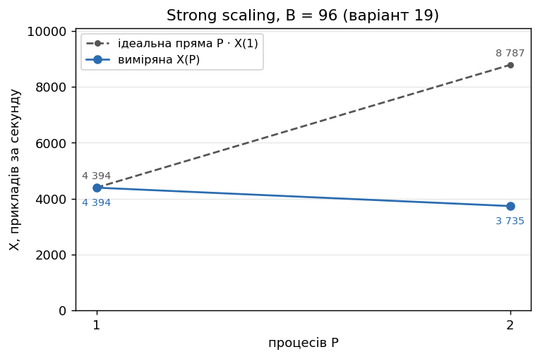
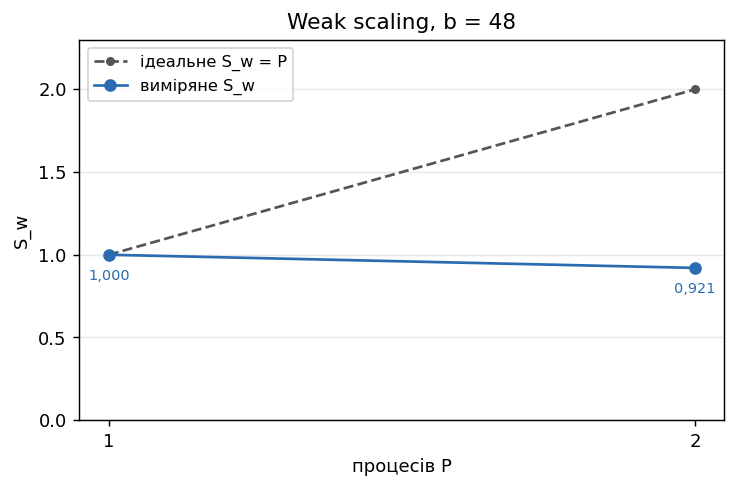
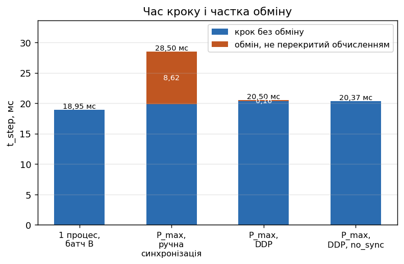
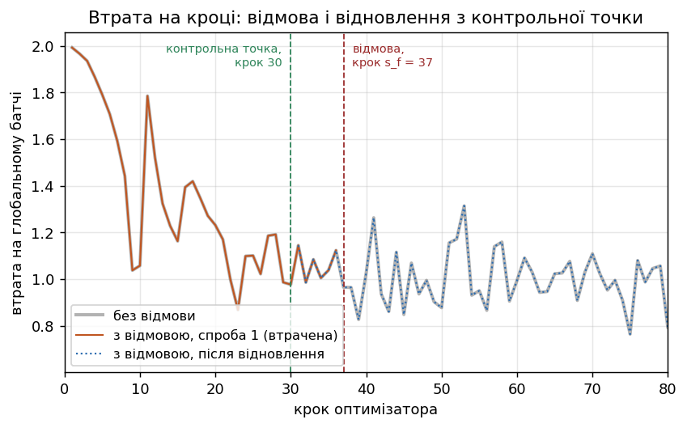

# Звіт: лабораторна робота 6. Розподілене навчання нейромережі за даними на CPU

**Варіант 19.** Датасет Д1 (DermaMNIST), ширина мережі Ш1, P_max = 2 процеси, глобальний
батч B = 96, інтервал контрольних точок K_c = 15 кроків, крок відмови s_f = 37. Сервіс
ЛР1–ЛР4 тут не задіяний: робота цілком у процесах Python на одному вузлі, без Docker,
кластера і бази.

| Параметр варіанта | Значення |
|---|---|
| Датасет | Д1, DermaMNIST: дерматоскопія, K = 7 класів, C = 3 канали, 7007 / 2005 прикладів |
| Ширина мережі | Ш1: c1 = 16, c2 = 32, h = 128 |
| Найбільша кількість процесів P_max | 2 |
| Глобальний батч B | 96 |
| Інтервал контрольних точок K_c | 15 кроків оптимізатора |
| Крок відмови s_f | 37 |
| Потоків на процес n_th = ⌊C_phys / P_max⌋ | ⌊4 / 2⌋ = 2 |
| Навчальна частина N | перші 7000 прикладів розбиття train |
| Оптимізатор | SGD, момент 0,9, η₀ = 0,02, n_ep = 3 епохи |

Запуск: [RUN-LAB6.md](RUN-LAB6.md), детально [HOWTO-LAB6.md](HOWTO-LAB6.md). Сирі дані:
`results/lab6/`, зведені таблиці — [results/lab6/tables.md](results/lab6/tables.md),
самоперевірка — [results/lab6/checks.md](results/lab6/checks.md), діаграми —
`results/lab6/charts/`.

## Умови

- Та сама машина, що в ЛР2–ЛР5: ноутбук Intel Core i7-1165G7 (4 фізичні ядра, 8
  логічних), 15,8 ГБ ОЗП, Windows 11. Python 3.10.11, PyTorch 2.14.0+cpu, бекенд
  обміну gloo через інтерфейс loopback, процеси запускає torchrun. GPU не задіяний.
- **Серії зняті 21.11.2026**: прогони навчання і прогін з відмовою — з 12:51 до 13:13,
  прогони вимірювання швидкості — з 13:17 до 13:53. Перед кожним прогоном оркестратор
  перевіряє живлення і чекає, доки фонове завантаження процесора впаде до 10 %, і
  записує умови в файл прогону (`host.conditions_before`, зведення — у розділі «Умови
  прогонів» [results/lab6/tables.md](results/lab6/tables.md)):
  - усі прогони — від мережі, режим економії заряду вимкнений, таймер Windows 1,0 мс;
    на батареї оркестратор серію не починає;
  - записане фонове завантаження прогонів швидкості — 5,0–26,5 %, переважно 6–10 %;
    один прогін навчання стартував при 38,7 % (на детерміновані ACC, AUC і втрати це не
    впливає, бо від часу вони не залежать).
  - Docker Desktop і кластер kind не працювали. Інші програми користувача (браузер,
    редактор, відеозвʼязок, запис екрана) лишались відкритими; закривати їх стенд не
    може, тому їхній вплив поданий як записане фонове завантаження і як розкид між
    прогонами.
- **Прогони навчання детерміновані**: `torch.manual_seed(0)` до створення моделі,
  `DistributedSampler` із зерном 0 і `set_epoch`, `num_workers=0`, у мережі немає
  Dropout і BatchNorm. Тому ACC, AUC і втрата на кожному кроці відтворюються точно і
  знімаються по одному прогону на режим.
- **Прогони вимірювання швидкості — по девʼять на конфігурацію**, бо час кроку на цьому
  ноутбуці розходиться між прогонами на десятки відсотків (розділ «Розкид між прогонами
  і відтворюваність»). У таблицях — медіана величини за девʼятьма прогонами; усередині
  прогону t_step уже є медіаною 50 вимірюваних кроків за методикою умови.
- Сім конфігурацій швидкості знімаються **по колу**: прогін 1 кожної, потім прогін 2 і
  так далі. Чому саме так — у розділі «Відхилення від умови і методичні рішення»; коротко:
  за прогонами поспіль повільний проміжок машини діставався цілій конфігурації, і
  різниця t_step − t_step,ns виходила відʼємною.

## Крок 1. Стенд і навчання в одному процесі

Датасет узято з офіційного архіву MedMNIST v3.0 на Zenodo (файл `dermamnist.npz`,
ліцензія CC BY-NC 4.0); пакет `medmnist` не потрібен. Навчальна частина — перші N = 7000
прикладів розбиття train, тестова — усе розбиття test (2005 прикладів). Значення
пікселів переведені в діапазон від −1 до 1.

Мережа — два згорткові шари з ReLU і підвибіркою 2 × 2 (28 × 28 → 7 × 7), прихований
повнозвʼязний шар і вихід на 7 класів:

n_params = 9 · 3 · 16 + 16 + 9 · 16 · 32 + 32 + 49 · 32 · 128 + 128 + 128 · 7 + 7 =
**206 823**, M = 4 · n_params = 827 292 Б = **0,789 МіБ**.

Кількість параметрів моделі збігається з формулою умови, 8 тензорів параметрів (вага і
зсув кожного з чотирьох шарів) — перевірено в
[results/lab6/checks.md](results/lab6/checks.md).

### Таблиця 1. Стенд

| Процесор | Фізичних ядер C_phys | Логічних ядер | Памʼять, ГБ | ОС | Python | PyTorch | n_th |
|---|---|---|---|---|---|---|---|
| Intel Core i7-1165G7 @ 2.80GHz | 4 | 8 | 15,8 | Windows 11 Home (10.0.26300) | 3.10.11 (CPython) | 2.14.0+cpu | 2 |

| Датасет | K | C | c1 / c2 / h | n_params | M, МіБ | N | B | P_max |
|---|---|---|---|---|---|---|---|---|
| dermamnist.npz (Д1) | 7 | 3 | 16 / 32 / 128 | 206 823 | 0,789 | 7 000 | 96 | 2 |

Фізичних ядер 4, тобто не менше за P_max = 2, тому n_th = ⌊C_phys / P_max⌋ = 2 і
запасний варіант умови (прогони на P_max процесах з n_th = 1) не потрібен.

Навчання в одному процесі без `torch.distributed`: n_e = ⌊7000 / 96⌋ = 72 кроки за
епоху, 216 кроків за три епохи, після них **ACC = 0,6753**, **AUC = 0,8254**.
Вимірювання швидкості за методикою умови (10 кроків прогріву, 50 вимірюваних):
**t_step = 18,95 мс**, **X(1) = 4 732 прикл./с**.

## Крок 2. Синхронізація градієнтів

Ручна синхронізація: перед першим кроком ваги процесу 0 розсилаються всім процесам
(`dist.broadcast(p.data, src=0)` для кожного параметра), після `loss.backward()` — по
одному `all_reduce` на кожен із восьми тензорів градієнта і ділення на P.

**Еквівалентність на першому батчі.** Один процес рахує градієнт g на всьому батчі з
B = 96 прикладів; на двох процесах процес r бере приклади з номерами r, r + 2, … того
самого батча і отримує ḡ ручною синхронізацією. Найбільше за тензорами відношення

max |g − ḡ| / max |g| = **2,11 · 10⁻⁶**,

по окремих тензорах від 6,2 · 10⁻⁸ (зсув вихідного шару) до 2,1 · 10⁻⁶ (вага другого
згорткового шару) — тобто рівно в межах 10⁻⁶–10⁻⁵, які називає умова. Що це саме
округлення суми у float32, а не різні обчислення, показує самоперевірка: та сама
перевірка в подвійній точності дає 1,04 · 10⁻¹⁵, а середнє локальних втрат збігається з
втратою на всьому батчі з точністю 2,2 · 10⁻¹⁶.

**Ваги після 50 кроків.** Кожен процес рахує суму всіх ваг у float64 і процеси
збирають суми через `all_gather`: обидві суми дорівнюють 22,765986941074430, різниця
**0** — ваги процесів лишаються побітово однаковими, і пересилати їх не треба.

### Таблиця 2. Синхронізація градієнтів

| Режим | t_step, мс | Час обміну на крок, мс | Частка кроку в обміні | X, прикл./с |
|---|---|---|---|---|
| 1 процес, батч B | 18,95 | 0 | 0 | 4 732 |
| P_max процесів, ручна синхронізація | 28,50 | 8,62 | 0,303 | 2 883 |
| P_max процесів, DDP | 20,50 | 0,16 | 0,008 | 3 735 |
| P_max процесів, DDP, no_sync | 20,37 | 0 | 0 | 3 795 |

| max \|g − ḡ\| / max \|g\| | Різниця сум ваг між процесами після 50 кроків | ACC, 1 процес | ACC, DDP на P_max | AUC, 1 процес | AUC, DDP на P_max |
|---|---|---|---|---|---|
| 2,11 · 10⁻⁶ | 0 | 0,6753 | 0,6823 | 0,8254 | 0,8300 |

**Ручна синхронізація коштує 8,62 мс на крок — 30 % часу кроку.** Це вісім окремих
колективних операцій, які всі починаються після завершення backward: модель мала
(0,79 МіБ градієнтів), тому в цих 8,62 мс майже немає передавання даних, а є вісім
затримок gloo на loopback, помножених на очікування другого процесу. У t_sync, як його
визначає умова (від першого виклику all-reduce до повернення з останнього), входить і
ділення градієнтів на P між викликами — окремий замір дає 0,096 мс, тобто 1,1 % цієї
величини.

**DDP ховає обмін майже цілком: t_comm,exp = 0,16 мс, c = 0,008.** Кошики DDP запускають
`all_reduce` ще під час backward, і з обчисленням не перекривається лише обмін останнього
кошика — з параметрами перших шарів. Для моделі 0,79 МіБ це частки мілісекунди.

Межа чутливості цього вимірювання — того ж порядку. Контроль: той самий розрахунок для
P = 1, де обміну немає за побудовою (один процес), дає 0,016 мс (c = 0,0008), а окремі
різниці t_step − t_step,ns по колах прогонів розкидані від −2,97 до +3,74 мс (плюс один
викид 44,00 мс у прогоні, де машина була зайнята стороннім). Тобто **виміряна частка
обміну DDP менша за один відсоток кроку, і це все, що можна стверджувати на цьому
стенді**: справжнє значення лежить між нулем і приблизно мілісекундою.

ACC і AUC одного процесу і DDP на двох процесах відрізняються в третьому знаку
(0,6753 проти 0,6823 і 0,8254 проти 0,8300). Крок оптимізатора в обох режимах той самий
(той самий B, та сама η₀, ті самі 216 кроків), а відрізняється порядок прикладів:
в одному процесі батчі складає `DataLoader(shuffle=True)`, у групі —
`DistributedSampler`. Різниця порядку прикладів такого масштабу і дає.

## Крок 3. Strong scaling

### Таблиця 3. Strong scaling, B = const

| P | b | t_step, мс | t_step,ns, мс | X, прикл./с | S | E | e | c |
|---|---|---|---|---|---|---|---|---|
| 1 | 96 | 19,78 | 18,28 | 4 394 | 1,000 | 1,000 | — | 0,001 |
| 2 | 48 | 20,50 | 20,37 | 3 735 | 0,850 | 0,425 | 1,353 | 0,008 |
| 3 | — | — | — | — | — | — | — | — |
| 4 | — | — | — | — | — | — | — | — |

Прискорення немає: **S(2) = 0,850**, тобто два процеси з фіксованим глобальним батчем
обробляють менше прикладів за секунду, ніж один. Метрика Карпа-Флатта e = 1,353 більша
за одиницю — формула дає таке значення, коли паралельний варіант повільніший за
послідовний, і «частка послідовної роботи» перестає бути змістовною величиною.

Частка обміну при цьому c = 0,008. Отже справа не в обміні, і наступний розділ показує,
у чому.

## Чому два процеси не прискорюють навчання

Зіставлення всередині самих вимірювань кроку 3 і 4 уже виключає обмін: прогін
`no_sync` на двох процесах (жодного `all_reduce` за весь прогін) дає t_step = 20,37 мс,
а той самий батч процесу b = 48 в одному процесі — 10,96 мс. **Крок подвоюється без
будь-якого обміну.**

Окремий дослід ([scripts/lab6_contention.py](scripts/lab6_contention.py),
`results/lab6/contention.json`) перевіряє це без `torch.distributed` взагалі: ті самі
10 + 50 кроків виконуються спершу в одному процесі, потім у двох процесах, які стартують
одночасно і нічого один одному не передають, по пʼять кіл.

| Що виконується | t_step, медіана, мс |
|---|---|
| один процес, батч 48, n_th = 2 | 12,12 |
| кожен із двох незалежних процесів, батч 48, n_th = 2 | 18,14 |

Два процеси, між якими немає ніякого звʼязку, сповільнюють один одного в **1,50 раза**.

Друга частина досліду показує причину — скільки обчислень машина взагалі віддає від
потоків (один процес, батч 48, пʼять кіл):

| n_th | t_step, медіана, мс | проти n_th = 1 |
|---|---|---|
| 1 | 15,32 | 1,00 |
| 2 | 9,85 | 1,56 |
| 4 | 10,85 | 1,41 |

Від одного потоку до двох виграш 1,56 раза, а **чотири потоки повільніші за два**. Тобто
більше двох активних потоків ця машина на цій мережі не окуповує — а P_max процесів по
n_th = 2 якраз і дають чотири активні потоки. Звідси й відсутність прискорення, яким би
ефективним не був обмін.

Чому саме так, цей стенд не міряє: частоту процесора під навантаженням я не знімав.
Правдоподібні обидві звичайні причини — падіння частоти ноутбучного процесора, коли
зайняті всі чотири ядра, і те, що згортки на картах 28 × 28 з батчем 48 замалі, щоб
ділитись між чотирма потоками без втрат. Для висновків роботи це не принципово: що б із
двох не переважало, воно лежить поза схемою паралелізму за даними і поза обміном.

Це не властивість DDP і не властивість схеми паралелізму за даними, а межа цього стенду.
На процесорі з більшою кількістю ядер або на GPU картина інша; умова прямо зазначає, що
на GPU обчислення кроку швидші в десятки разів і частка обміну більша за виміряну тут.

## Крок 4. Weak scaling і правило масштабування швидкості навчання

### Таблиця 4. Weak scaling, b = const

| P | B_P | t_step, мс | X, прикл./с | S_w | E_w |
|---|---|---|---|---|---|
| 1 | 48 | 10,96 | 4 057 | 1,000 | 1,000 |
| 2 | 96 | 20,50 | 3 735 | 0,921 | 0,460 |
| 3 | — | — | — | — | — |
| 4 | — | — | — | — | — |

За незмінного батча процесу b = 48 два процеси обробляють 3 735 прикл./с проти 4 057 в
одного, S_w = 0,921 замість ідеальних 2. Причина та сама, що в кроці 3: час кроку
зростає з 10,96 до 20,50 мс, і з них на не перекритий обчисленням обмін припадає 0,16 мс.

### Таблиця 5. Якість за різних глобальних батчів

| Режим | B_P | η | Кроків оптимізатора за n_ep = 3 епох | ACC | AUC | Найбільша втрата за останню епоху |
|---|---|---|---|---|---|---|
| P = 1 | 48 | η₀ = 0,02 | 435 | 0,7007 | 0,8457 | 1,2590 |
| P = P_max, з кроку 2 | 96 | η₀ = 0,02 | 216 | 0,6823 | 0,8300 | 1,1630 |
| P = P_max | 96 | η_P = η₀ · B_P / B₀ = 0,04 | 216 | 0,6958 | 0,8442 | 1,1071 |

Подвоєння глобального батча за ту саму кількість епох удвічі зменшує кількість оновлень
ваг (435 проти 216 кроків), і якість падає: ACC з 0,7007 до 0,6823, AUC з 0,8457 до
0,8300.

**Лінійне правило відіграє більшу частину втрати**: η_P = 0,04 піднімає ACC до 0,6958
(73 % розриву) і AUC до 0,8442 (90 % розриву). Розходження навчання, якого умова просить
стерегтися, не трапилось: найбільша втрата за останню епоху з більшою швидкістю навчання
навіть менша (1,1071 проти 1,1630), а найбільша втрата першої епохи припадає на перший
крок (1,9928) — тобто навчання жодного разу не піднялось вище початкового рівня. Від
кроку до кроку втрата коливається (зростання у 30 з 71 переходу першої епохи), але так
само і за η₀ = 0,02 (31 з 71): це звичайний розкид між батчами, а не розходження. За
подвоєння η з 0,02 до 0,04 це очікувано — правило стає небезпечним на набагато більших
батчах, де потрібен розігрів.

## Крок 5. Відмова і відновлення

Контрольну точку пише лише процес 0 кожні K_c = 15 кроків: `torch.save` у `ckpt.tmp`,
далі `os.replace` на `ckpt.pt`, далі `dist.barrier()`. Файл містить стан моделі, стан
оптимізатора (моменти SGD), номер епохи, номер батча в епосі і номер кроку — 1 659 697 Б
(дві копії ваг по 0,79 МіБ плюс службові поля). Атомарне перейменування означає, що
процес, завершений під час запису, не лишає пошкодженої контрольної точки.

Відмова: процес rank P_max − 1 = 1 на початку кроку s_f = 37 створює файл-позначку (щоб
після перезапуску не впасти знову) і завершується викликом `os._exit(1)`. Процес 0 у цей
момент стоїть у колективній операції. Агент torchrun бачить ненульовий код виходу,
зупиняє групу і запускає обидва процеси повторно (`--max-restarts=1`, статична адреса
групи 127.0.0.1:29500). Під час старту кожен процес читає `ckpt.pt`, відновлює модель і
оптимізатор, викликає `sampler.set_epoch(epoch)` і пропускає перші `step_in_epoch` батчів
епохи.

### Таблиця 6. Відмова і відновлення

| K_c | s_f | Крок останньої контрольної точки | Кроків виконано повторно | t_lost, с |
|---|---|---|---|---|
| 15 | 37 | 30 | 6 | 73,90 |

| Крок | 35 | 36 | 37 | 38 | 39 | ACC після n_ep = 3 епох |
|---|---|---|---|---|---|---|
| Втрата, прогін з відмовою | 1,0386 | 1,1238 | 0,9657 | 0,9648 | 0,8274 | 0,6823 |
| Втрата, прогін без відмови | 1,0386 | 1,1238 | 0,9657 | 0,9648 | 0,8274 | 0,6823 |

**Відновлення точне.** Збігаються не тільки пʼять кроків таблиці: самоперевірка звіряє
всі 186 кроків після відновлення з прогоном без відмови — розбіжностей нуль, ACC після
трьох епох однаковий до останнього знака (0,6822942643391521). Повторно виконані кроки
31-36, крок 37 до відмови не виконувався взагалі. Середня втрачена робота за умовою —
K_c / 2 = 7,5 кроку, виміряна — 6 кроків.

**t_lost = 73,90 с, і з них на корисну роботу припадає 0,16 с.** Складові:

| Складова | Значення |
|---|---|
| t_f − t_c, робота від контрольної точки на кроці 30 до відмови | 0,16 с |
| t_r, від відмови до завершення першого кроку після відновлення | 73,74 с |
| з t_r: агент torchrun записав про відмову процесу | через 60,26 с після неї |
| з t_r: перезапущені процеси почали роботу | через 73,66 с після відмови |
| з t_r: читання контрольної точки і перший крок після нього | 0,05 с |

Майже весь t_lost — це зупинка групи, а не втрачене навчання. Процес 0 стоїть у
колективній операції gloo і сигналу про завершення не обробляє, тому агент спершу
надсилає йому CTRL_C_EVENT і чекає 30 с, і лише потім продовжує зупинку — у журналі
агента (`results/lab6/s5_failure/torchrun.log`) це видно прямо: о 13:12:43 рядок
«Process 3304 did not exit after CTRL_C_EVENT within 30s; abandoning and continuing
teardown», одразу за ним запис про відмову процесу rank 1 і далі SIGTERM другому
процесу. Шість утрачених кроків навчання коштують 0,16 с, читання
контрольної точки — 0,05 с: **ціна відмови на цьому стенді визначається механікою
перезапуску групи, а не розміром моделі й не інтервалом K_c**. Збільшення K_c у кілька
разів змінило б t_lost на частки секунди.

Контрольний прогін тієї самої конфігурації з контрольними точками, але без відмови, дає
ті самі втрати на всіх 216 кроках і той самий ACC: **запис контрольних точок на навчання
не впливає**.

## Самоперевірка

[results/lab6/checks.md](results/lab6/checks.md) — 50 перевірок, усі пройдені. Кожна
звіряє число не з ним самим, а з формулою умови, з параметрами умови або з незалежною
реалізацією:

- n_params моделі = формула умови = розрахунок для Ш1 і Д1 вручну (206 823); 8 тензорів
  параметрів; карта ознак після двох підвибірок 7 × 7; у мережі немає BatchNorm і
  Dropout, тому рівність ḡ = g виконується точно;
- вміст датасету: N = 7000 перших прикладів train, 2005 тестових, форма (3, 28, 28),
  нормування в [−1, 1], перетворення пікселів звірене з незалежним перерахунком, мітки
  0…6;
- n_e = ⌊⌈N / P⌉ / b⌋ для трьох режимів збігається з кількістю кроків у прогонах
  (72, 72, 145);
- `DistributedSampler`: частини однакової довжини ⌈N / P⌉ = 3500, не перетинаються, разом
  дають усі 7000 індексів, складаються в одну перестановку позиціями r, r + P, …,
  `set_epoch` перестановку змінює, кількість батчів дорівнює n_e;
- ḡ = g у подвійній точності (1,04 · 10⁻¹⁵) проти float32 (2,17 · 10⁻⁶); середнє
  локальних втрат = втрата на батчі B;
- ACC і AUC функцій прогону проти власних реалізацій: частка правильних і macro-OVR AUC
  через U-статистику Манна-Вітні (без scikit-learn) збігаються до 10⁻⁹;
- X = 50 · B / t і t_block = сума часу 50 кроків — у всіх 63 прогонах швидкості;
- S, E, e, c, S_w, E_w перераховані з X і t_step дають ті самі числа, що в таблицях
  (c — з медіани різниці по колах);
- відновлення: 186 кроків після відмови збігаються з прогоном без відмови, ACC
  однаковий, контрольні точки на навчання не впливають, кроків повторно = s_f − 1 −
  крок точки, точка кратна K_c, t_lost = (t_f − t_c) + t_r, запис точки атомарний, у
  файлі є модель, оптимізатор, епоха і крок;
- звірка з умовою: параметри варіанта і спільні параметри навчання, n_th = 2 і
  OMP_NUM_THREADS = 2 в усіх 70 прогонах, режими кроків 1, 2, 4 і 5 (sync, P, b, B, η,
  епохи), прогін кроку 1 справді без `torch.distributed`, рядки P = 1 таблиць 3 і 4,
  типовий розмір кошика DDP, команда прогону з відмовою (`--max-restarts=1`, адреса,
  K_c, s_f), 10 + 50 кроків у кожному прогоні швидкості, живлення від мережі в усіх
  прогонах.

## Розкид між прогонами і відтворюваність

| Конфігурація | t_step медіана, мс | від–до, мс | розкид, % медіани | розкид між квартилями, % |
|---|---|---|---|---|
| 1 процес, батч B | 18,95 | 17,25–36,40 | 101 | 21 |
| P_max, ручна синхронізація | 28,50 | 22,95–34,63 | 41 | 26 |
| P_max, DDP | 20,50 | 18,11–62,61 | 217 | 23 |
| P_max, DDP, no_sync | 20,37 | 17,22–22,86 | 28 | 12 |
| strong, P = 1 | 19,78 | 17,12–34,39 | 87 | 24 |
| strong, no_sync, P = 1 | 18,28 | 16,49–24,09 | 42 | 23 |
| weak, P = 1 | 10,96 | 9,81–13,50 | 34 | 15 |

Повний розкид створюють поодинокі прогони, у яких машина була зайнята стороннім (межі
101 % і 217 % — це по одному прогону з девʼяти); між квартилями прогони розходяться на
12–26 %. Медіана до одного такого прогону нечутлива, а X за методикою умови рахується з
тривалості 50 кроків, тобто із середнього, і тому розходиться сильніше (27–90 %). Для
порівняння стійкості в [results/lab6/tables.md](results/lab6/tables.md) наведена оцінка
B / t_step з медіанного кроку.

**Перша серія** (`results/lab6/v1/`) знята по три прогони на конфігурацію і серіями
поспіль, а не по колу:

| Конфігурація | v1, t_step | основна, t_step | різниця |
|---|---|---|---|
| 1 процес, батч B | 22,78 мс | 18,95 мс | −17 % |
| P_max, ручна синхронізація | 26,50 мс | 28,50 мс | +8 % |
| P_max, DDP | 20,75 мс | 20,50 мс | −1 % |
| P_max, DDP, no_sync | 22,53 мс | 20,37 мс | −10 % |
| strong, P = 1 | 20,95 мс | 19,78 мс | −6 % |
| weak, P = 1 | 11,31 мс | 10,96 мс | −3 % |

Медіани розійшлись на 1–17 %, тобто в межах розкиду. А от похідна величина t_comm,exp у
першій серії вийшла **відʼємною** (−1,78 мс, c = −0,086): різниця двох медіан, знятих у
різний час, містить дрейф машини, який більший за саму величину. Це і змусило перейти на
зняття по колу і на медіану парних різниць (див. нижче). Якісні висновки обох серій
однакові: ручна синхронізація коштує близько 30 % кроку, DDP — одиниці відсотків або
менше, прискорення від двох процесів немає.

Прогони навчання відтворюються точно: ACC, AUC і втрати на кожному кроці в прогоні з
відмовою, у контрольному прогоні з точками і в прогоні кроку 2 збігаються до останнього
знака.

## Звірка з умовою

| Що вимагає умова | Де виконано |
|---|---|
| Крок 1: завантажити датасет варіанта, побудувати мережу ширини варіанта, обчислити n_params і M | розділ «Крок 1», таблиця 1; `results/lab6/stand.json` |
| Крок 1: n_th = ⌊C_phys / P_max⌋ в усіх прогонах | n_th = 2; перевірено в усіх 70 прогонах (самоперевірка) |
| Крок 1: навчити n_ep епох в одному процесі **без** `torch.distributed`, записати ACC і AUC | ACC 0,6753, AUC 0,8254; `s1_single_train.json` (`sync = none`) |
| Крок 1: окремо зміряти t_step і X(1) | 18,95 мс і 4 732 прикл./с, перший рядок таблиці 2 |
| Крок 2: torchrun, група gloo, розсилка ваг з процесу 0, `DistributedSampler`, b = B / P_max, ручна синхронізація | [lab6/train.py](lab6/train.py): `broadcast_weights`, `manual_sync`; прогони `s2_speed_manual_r*` |
| Крок 2: max \|g − ḡ\| / max \|g\| на першому батчі з B прикладів | 2,11 · 10⁻⁶, `s2_equiv.json` (частки по 48 прикладів, індекси r, r + P, …) |
| Крок 2: різниця сум ваг у float64 через `all_gather` після 50 кроків | 0, `s2_equiv.json` |
| Крок 2: t_step і t_sync з ручною синхронізацією | 28,50 і 8,62 мс, таблиця 2 |
| Крок 2: DDP з типовим розміром кошика, t_step, окремий прогін t_step,ns, t_comm,exp і c | 20,50 і 20,37 мс, t_comm,exp = 0,16 мс, c = 0,008; `bucket_cap_mb` не задається |
| Крок 2: навчання з DDP n_ep епох, втрата на кожному кроці, ACC і AUC | `s2_train_ddp.json` (216 кроків у `loss_history`), ACC 0,6823, AUC 0,8300 |
| Крок 3: strong scaling з DDP, P від 1 до P_max, прогін P = 1 теж через torchrun з DDP | таблиця 3; `s3_speed_ddp_p1_r*` (sync = ddp, P = 1, B = 96) |
| Крок 3: S, E, e, c і графік X(P) з ідеальною прямою P · X(1) | таблиця 3, `results/lab6/charts/strong_scaling.png` |
| Крок 4: weak scaling, b = B / P_max, рядок P = P_max з таблиці 3, S_w і E_w | таблиця 4 |
| Крок 4: ще два прогони навчання — P = 1 з батчем b і η₀; P_max з η_P за лінійним правилом | `s4_train_p1_b.json` (η = 0,02), `s4_train_lin.json` (η = 0,04) |
| Крок 4: кроки оптимізатора, ACC, AUC і найбільша втрата за останню епоху для трьох режимів | таблиця 5 |
| Крок 5: контрольні точки кожні K_c = 15 кроків і відновлення під час старту | `save_ckpt` + відновлення в `task_train`; `s5_failure/ckpt.pt`, журнали подій |
| Крок 5: відмова процесу rank P_max − 1 на початку кроку s_f = 37 через `os._exit(1)` з файлом-позначкою | `s5_failure/failed.marker`, подія `fail` у `events-rank1.jsonl` |
| Крок 5: torchrun з `--max-restarts=1` і статичною адресою групи | команда прогону в `s5_failure/result.json`; адреса 127.0.0.1:29500 (бекенд рандеву — див. відхилення нижче) |
| Крок 5: крок останньої точки, кроків повторно, t_lost, втрати на s_f ± 2 і ACC проти прогону без відмови | таблиця 6 |
| Методика: 10 кроків прогріву, 50 вимірюваних, t_step — медіана 50 кроків процесу 0, X = 50 · B / t, `time.perf_counter` | перевірено в усіх 63 прогонах швидкості (самоперевірка) |
| Параметри: η₀ = 0,02, момент 0,9, зерно 0, N = 7000, тест — усе розбиття test, n_ep = 3 | перевірено в самоперевірці |

Усі 50 перевірок [results/lab6/checks.md](results/lab6/checks.md) пройдені; 15 з них —
саме звірка знятих прогонів з параметрами умови (режими, n_th, батчі, швидкості
навчання, методика вимірів, команда прогону з відмовою), решта — перерахунок чисел за
формулами умови і незалежними реалізаціями.

## Відхилення від умови і методичні рішення

| Що | Чому |
|---|---|
| `torchrun` запускається через обгортку [scripts/lab6_torchrun.py](scripts/lab6_torchrun.py) | збірка `torch 2.14.0+cpu` для Windows не містить libuv, а агент elastic створює `TCPStore` із типовим `use_libuv=True` і падає ще до старту процесів навчання. Обгортка підставляє `use_libuv=False` там, де store створює агент, і викликає той самий `torch.distributed.run`, що й `torchrun`; решта поведінки не змінюється. Сам torch для `env://` на win32 типово бере `use_libuv=0`, тобто підміна лише поширює його ж вибір |
| Рандеву прогону з відмовою — `--rdzv-backend=c10d --rdzv-endpoint=127.0.0.1:29500` замість `--rdzv-backend=static` | зі `static` на цій збірці перезапущені після відмови процеси зависають: відмова і перезапуск відбуваються, але далі обидва процеси стоять в `init_process_group` і прогін не завершується (відтворення з журналами і розбором — [results/lab6/static_rdzv/](results/lab6/static_rdzv/README.md): записів `resume` чи другої спроби немає взагалі, через 8 хвилин процеси зупинені вручну). Адреса і порт групи при `c10d` так само статичні й задані явно, перезапущені процеси знаходять один одного за ними, і `--max-restarts=1` працює |
| t_comm,exp = медіана різниць t_step − t_step,ns у межах одного кола прогонів, а не різниця медіан | розкид t_step між прогонами (12–26 % між квартилями) того самого порядку, що й уся величина, яку міряємо. Різниця медіан двох конфігурацій містить дрейф машини між ними і в першій серії дала відʼємне значення. Формула умови застосована до кожного кола, де обидва режими зняті один за одним; обидві оцінки є в `summary.json` |
| Девʼять прогонів на конфігурацію замість одного | умова задає медіану 50 кроків усередині прогону, але не повтори. На ноутбуці одного прогону мало: межі t_step розходяться вдвічі-втричі. Усі девʼять прогонів кожної конфігурації — у `results/lab6/*_r*.json` |
| Рядок «P = 1» таблиці 5 знято через torchrun з DDP на одному процесі | крок 4 міряє weak scaling з DDP, і рядок P = 1 таблиці 4 — теж DDP на одному процесі; щоб якість і швидкість стосувались того самого режиму, навчання P = 1 з батчем b зняте так само. Перший рядок таблиці 2 — навпаки, строго без `torch.distributed`, як вимагає крок 1 |
| Втрата на кроці в прогонах навчання — втрата на глобальному батчі (`all_reduce` локальних втрат і ділення на P) | частки батча однакового розміру, тому це точно втрата на всьому батчі B і величина порівнянна між режимами з різним P. У прогонах вимірювання швидкості цього зведення немає, щоб не додавати обмін до часу кроку |
| Крок міряється разом з отриманням батча з `DataLoader` | так t_block дорівнює сумі часу 50 кроків, і X = 50 · B / t_block узгоджена з t_step. Дані лежать у памʼяті (`TensorDataset`, `num_workers=0`), тож внесок вибірки батча малий |
| Прогони навчання і прогін з відмовою зняті в першому проході серії, прогони швидкості — у другому | навчання детерміноване, його числа від часу не залежать. Перезнімались тільки вимірювання швидкості, бо змінилась методика (зняття по колу) |
| Датасет завантажений з Zenodo без пакета `medmnist` | умова прямо дозволяє обидва способи; файл той самий |
| У таблицях стоїть X за методикою умови (з тривалості 50 кроків), а стійкіша оцінка B / t_step наведена окремо | X за умовою рахується із середнього часу кроку і чутлива до поодиноких довгих кроків; підміняти формулу умови власною не можна, але показати обидві — можна |

## Що з цього випливає

- **Паралелізм за даними дає той самий крок, що й один процес на всьому батчі.**
  max |g − ḡ| / max |g| = 2,11 · 10⁻⁶ у float32 і 1,04 · 10⁻¹⁵ у float64 — різниця
  цілком пояснюється порядком додавання, а ваги процесів після 50 кроків побітово
  однакові.
- **Ручна синхронізація коштує 30 % часу кроку, DDP — менше одного відсотка.** Вісім
  окремих `all_reduce` після backward дають 8,62 мс; кошики DDP, запущені під час
  backward, лишають не перекритими 0,16 мс. Для моделі 0,79 МіБ це різниця між помітною
  і непомітною платою за синхронізацію.
- **Прискорення на цьому стенді немає ні в strong, ні в weak scaling**: S(2) = 0,850,
  S_w(2) = 0,921. Причина не в обміні (c = 0,008), а в машині: два незалежні процеси без
  жодного обміну сповільнюють один одного в 1,50 раза, а один процес на чотирьох потоках
  повільніший, ніж на двох. Чотириядерний процесор ноутбука більше двох активних потоків
  для цієї мережі не окуповує.
- **Більший глобальний батч за ту саму кількість епох коштує якості**: удвічі менше
  оновлень ваг, ACC 0,6823 проти 0,7007. Лінійне правило η_P = η₀ · B_P / B₀ відіграє
  73 % розриву за ACC і 90 % за AUC, і розходження навчання за подвоєння η не настає.
- **Відновлення з контрольної точки точне**: усі 186 кроків після відмови і ACC
  збігаються з прогоном без відмови до останнього знака, запис точок на навчання не
  впливає.
- **Ціну відмови визначає не модель, а перезапуск групи**: з t_lost = 73,90 с на
  втрачене навчання припадає 0,16 с і на читання контрольної точки 0,05 с, решта — час,
  поки агент torchrun зупиняє процес, що стоїть у колективній операції. На такій моделі
  K_c можна робити значно більшим без помітної шкоди.
- **Абсолютні числа цього стенду відтворюються в межах десятків відсотків**, а похідні
  різниці двох прогонів — тільки якщо прогони зняті поруч у часі. Відношення (S, E, c,
  частки) стійкіші за абсолютні X.

## Використання генеративних моделей

**Оформлення тексту.** Структура розділів, зведення чисел у таблиці.

**Помилки і помилкові гіпотези, знайдені під час роботи:**

- Перша серія дала відʼємний час обміну DDP (t_comm,exp = −1,78 мс, c = −0,086).
  Причина не в коді, а в порядку зняття: усі прогони однієї конфігурації йшли поспіль, і
  повільний проміжок машини дістався цілій конфігурації `no_sync`. Зняття переведено на
  порядок по колу, t_comm,exp рахується як медіана парних різниць, перша серія збережена
  в `results/lab6/v1/` і порівняна в розділі «Відтворюваність».
- Відсутність прискорення спершу була віднесена на обмін. Власні числа цього не
  підтвердили: c = 0,008, а прогін `no_sync` на двох процесах (без жодного `all_reduce`)
  такий самий повільний. Доданий окремий дослід без `torch.distributed`, який показав,
  що два незалежні процеси сповільнюють один одного в 1,50 раза, а чотири потоки
  повільніші за два.
- Прогін з відмовою зі `--rdzv-backend=static`, як у прикладі умови, на цій збірці
  PyTorch зависає після перезапуску: обидва процеси стоять в `init_process_group`.
  Відтворено окремо, журнал збережено (`results/lab6/static_rdzv/torchrun.log`);
  перейдено на рандеву `c10d` з тією самою статичною адресою.
- У таблиці 6 спершу було написано, що крок s_f виконано повторно. Насправді процес
  завершується *на початку* кроку 37, тому цей крок до відмови не виконувався зовсім, а
  повторно виконані кроки 31-36. Формулювання виправлено.
- Час t_r спершу був пояснений як очікування SIGTERM. У журналі агента видно інше: на
  Windows агент надсилає CTRL_C_EVENT, чекає 30 с, пише «did not exit after
  CTRL_C_EVENT within 30s» і лише потім переходить до SIGTERM. Пояснення замінено тим,
  що є в журналі.
